<div align="center">

<picture>
  <source media="(prefers-color-scheme: dark)" srcset="assets/hero-dark.svg">
  <source media="(prefers-color-scheme: light)" srcset="assets/hero-light.svg">
  
</picture>

<h3>Effortless, Zero-Hallucination 2D/3D CAD &amp; Civil Bridge Engineering Automation for AI Agents</h3>

<!-- Language Switcher Pills -->
<p>
  <a href="README.md"></a>
  <a href="README_ZH.md"></a>
</p>

<!-- Primary Status & Capability Badges -->
<p>
  <a href="https://github.com/XiaoGuai23/cad-operations-skill/actions/workflows/smoke-test.yml"></a>
  <a href="https://github.com/XiaoGuai23/cad-operations-skill/releases"></a>
  
  
  <a href="references/mcp-server-guide.md"></a>
  <a href="SKILL.md"></a>
  <a href="LICENSE"></a>
</p>

<p>
  
  
</p>

<!-- Quick Anchor Navigation Bar -->
<p>
  <a href="#visual-showcase"><b>Visual Showcase</b></a> ·
  <a href="#civil--highway-bridge-deliverables--interactive-ui"><b>🌉 Civil &amp; Bridge Suite</b></a> ·
  <a href="#what-you-can-do"><b>What You Can Do</b></a> ·
  <a href="#core-modules"><b>Core Modules</b></a> ·
  <a href="#quick-start"><b>Quick Start</b></a> ·
  <a href="#mcp--agent-integration"><b>MCP &amp; Agents</b></a> ·
  <a href="README_ZH.md"><b>中文文档</b></a>
</p>

</div>

---

**CAD Operations Skill** is an industrial-grade 2D & 3D CAD generation, civil & bridge engineering suite, surgical vector revision, and legacy drawing audit platform built for AI coding agents (**Claude Code, Cursor, Codex, Antigravity**) and automated engineering pipelines.

Compile `.docx` / `.pdf` / `.md` specifications into collision-free **GB/T & ISO blueprints**, deliver complete **22-sheet A3 highway bridge construction drawing albums + Word graduation theses**, build watertight **3D STEP/GLB solids**, inspect wild legacy DXFs for **tampered dimensions & micro-gaps**, and revise exact entities through **point-click / marquee Red-Green Vector Diff**—all protected by SHA-256 hash locks and `compare_untouched` out-of-scope guardrails.

Use it from **Python**, the **CLI**, the built-in **Web Studio** (`/studio`), or connect any AI agent via its **28-tool MCP Server** (`stdio` & Streamable HTTP).

---

## Visual Showcase

<table>
  <tr>
    <td width="50%" align="center">
      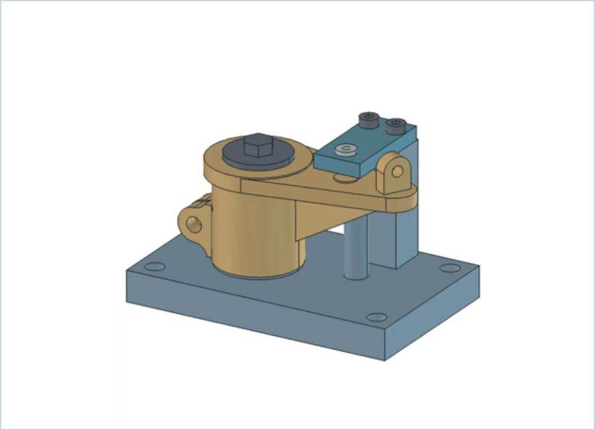<br/>
      <sub><b>3D Mechanical Assembly</b> — Multi-part drilling jig solid model</sub>
    </td>
    <td width="50%" align="center">
      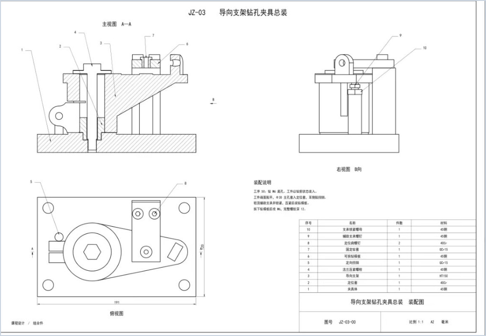<br/>
      <sub><b>Matched GB/T 2D Assembly Sheet</b> — <code>A-A</code> section hatching, leader balloons &amp; 10-row bottom-up BOM</sub>
    </td>
  </tr>
  <tr>
    <td width="50%" align="center">
      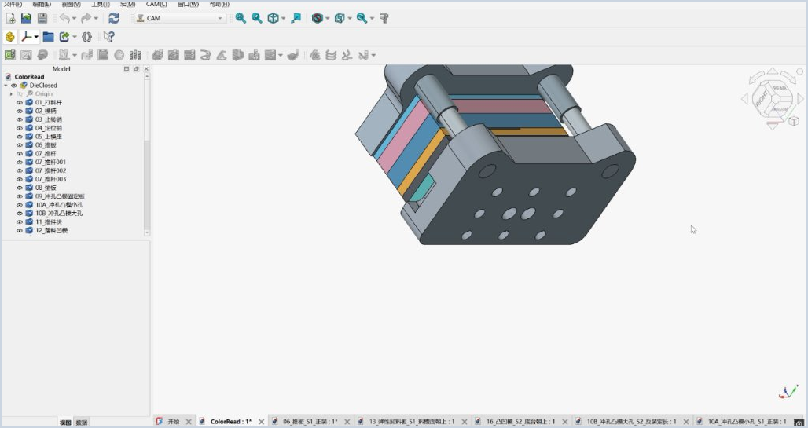<br/>
      <sub><b>Multi-Plate Die Tooling</b> — Color-coded 12-component progressive die STEP assembly</sub>
    </td>
    <td width="50%" align="center">
      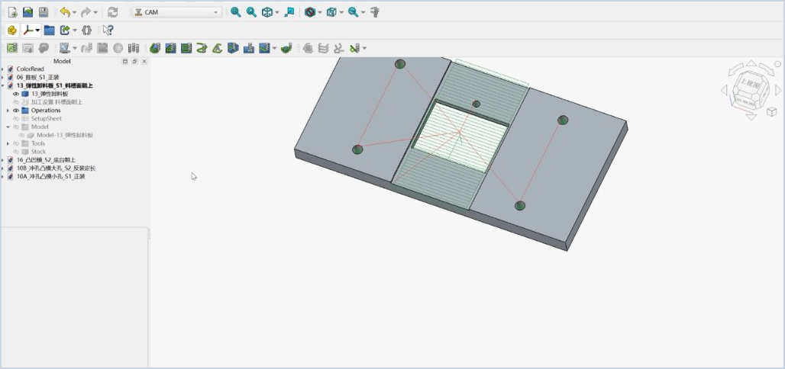<br/>
      <sub><b>Downstream CAM Ready</b> — Watertight B-Rep/STEP geometry feeding directly into CNC toolpaths</sub>
    </td>
  </tr>
</table>

<details>
<summary><b>📐 View Full-Sheet Municipal &amp; Process Elevation Blueprint Example</b> (Click to expand)</summary>
<br/>
<p align="center">
  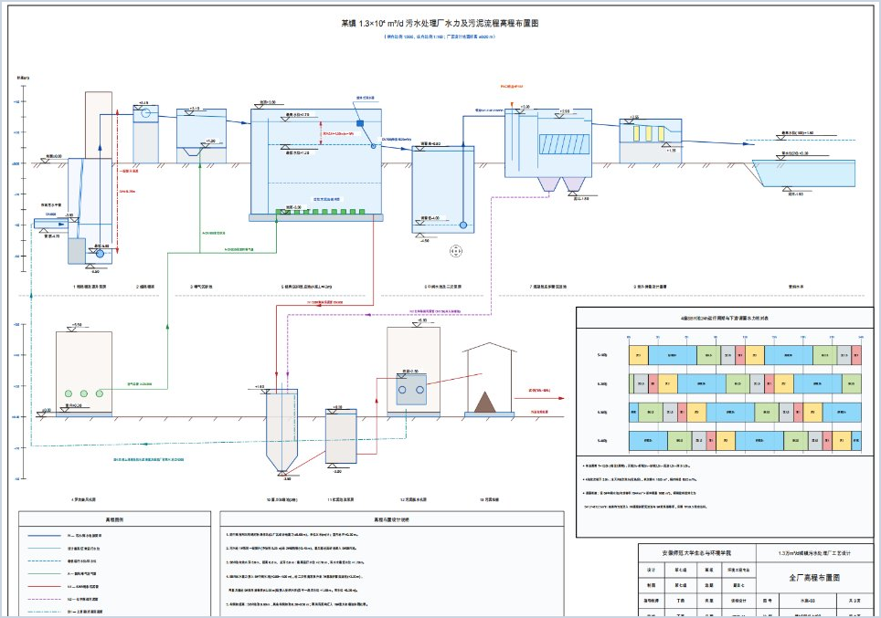<br/>
  <sub>Multi-domain drafting coverage across mechanical parts/assemblies, 22-sheet highway bridges, substation single-line diagrams (SLD), pavement cross-sections, and municipal process sheets.</sub>
</p>
</details>

---

## Civil & Highway Bridge Deliverables & Interactive UI

Built for **civil engineering graduation designs, bridge coursework, and highway bridge construction documentation** (`JTG D60-2015`, `JTG 3362-2018`, `JTG 3363-2019`, `JT/T 4-2019`), the skill provides a zero-commercial-CAD pipeline from **hydrology & geotechnical survey ingestion → superstructure/substructure analysis → FEM verification → 22-sheet A3 CAD album → formal `.docx` thesis** ([Full Guide →](references/civil-bridge-engineering.md)):

### 1. Five Core Bridge Engineering Deliverable Suites

| Deliverable Suite | Engineering Scope & Built-in Guardrails | Output Formats |
| :--- | :--- | :--- |
| **① 22-Sheet A3 Construction CAD Album** (plus 18-sheet `QL` compatibility) | Covers all **9 task-book categories**: `01` Design Notes & Index, `02` Bridge-Wide BOQ, `03/04` Elevation & Plan (`1:400`, flood level, independent `21 m` pier & `15 m` abutment piles), `05` `2%` Cross-Slope Deck Section (comb leaders + wet-joint detail), `06/07` Precast `C50` T-Girder Geometry, `08/09` Prestressing Tendons & **3D Coordinates + `DW1` Positioning Mesh**, `10–12` Web/Flange/Diaphragm Rebar, `13/14` Elastomeric Bearings & Deck Ancillaries, `15/16` Double-Column Pier & Pile-Bent Abutment (shared **`480+40+480=1000 mm`** support chain), `17–21` Pier Cap, Seismic Block (`DK1`), **Pile-Top Tie-Beam Joint `19-1`**, and Abutment Ear/Backwall (`EB1–EB3`). Reopen-DXF verified. | `.dxf` · Bookmarked `.pdf` · `.png` |
| **② 6 Publication-Grade 300-DPI Figures** | 3-scheme bridge comparison (precast T-girder / continuous box / precast small box), exterior/interior T-girder sections, structural calculation model, M/Q load envelopes, tendon profile & effective prestress curve, and pier vs. abutment bored-pile soil profiles. | `300 DPI .png` · Vector `.svg` |
| **③ College-Template Word Thesis & Calc Book** | Privacy-clean cover page, bilingual abstracts, **3-level hyperlinked bookmark TOC**, 11 chapters of step-by-step formula substitutions, cross-page auto-continuation 3-line tables, **12 inline-cited Chinese & English references**, and 6-field rebar/tendon provenance lookup (`N4`, `DW1`, `XL1`, `EB1`). | `.docx` · `.md` · `.json` |
| **④ Strict Dr.Bridge / Midas FEM Audit & 3D Tendon Clearance** | Item-by-item verification of superstructure & substructure FEM tables (blocks serviceability values from masquerading as ULS combinations; flags missing items as `partially_verified`); station-by-station 3D tendon & duct cover audit (catches **`N4` `10 mm` web overrun at `x=2980 mm`**); built-in 2D planar frame stiffness solver `[K]{u}={F}`. | Defense comparison table · Clearance JSON |
| **⑤ Automatic `.docx` / `.dxf` Style Learning & Change Impact** | Drop in any university reference `.docx` and sample `.dxf` sheets to learn typography, margins, 3-line tables, and CAD layers/lineweights into `.cad-memory/`; deterministic semantic DXF digest reports exact affected chapters & sheets on parameter changes (0 false positives on identical re-runs). | `.cad-memory/*.json` · `change_impact_report.json` |

### 2. Sample Graduation-Design CAD Sheets (`4×25 m` Precast Prestressed T-Girder Bridge)

<table>
  <tr>
    <td width="50%" align="center">
      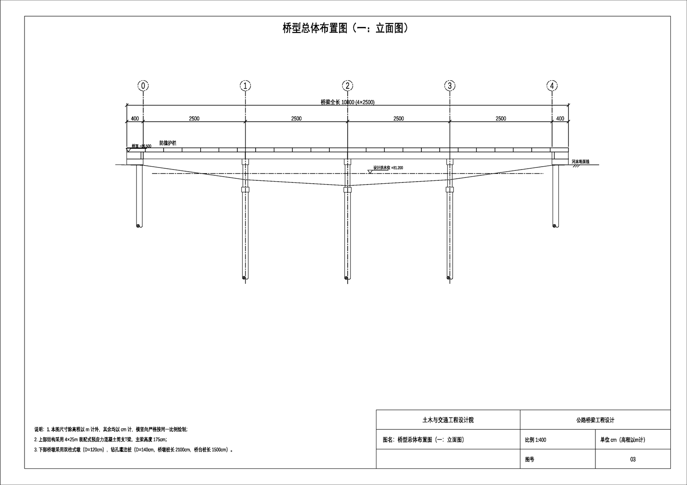<br/>
      <sub><b>Sheet 03 · General Elevation (1:400)</b> — 4×25 m span chain, design flood level, and independent 21 m pier / 15 m abutment bored piles</sub>
    </td>
    <td width="50%" align="center">
      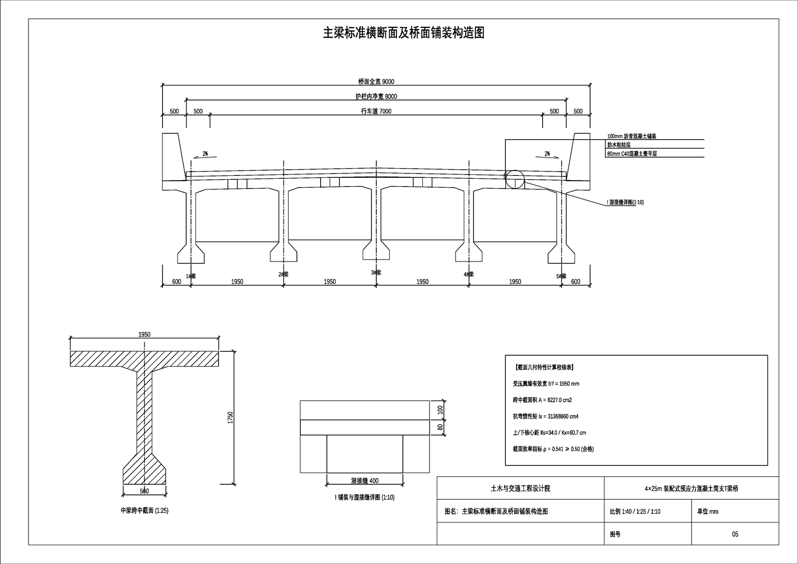<br/>
      <sub><b>Sheet 05 · Standard Deck Cross-Section</b> — 5 precast C50 T-girders, true 2% bidirectional cross-slope, comb leaders &amp; section property table</sub>
    </td>
  </tr>
  <tr>
    <td width="50%" align="center">
      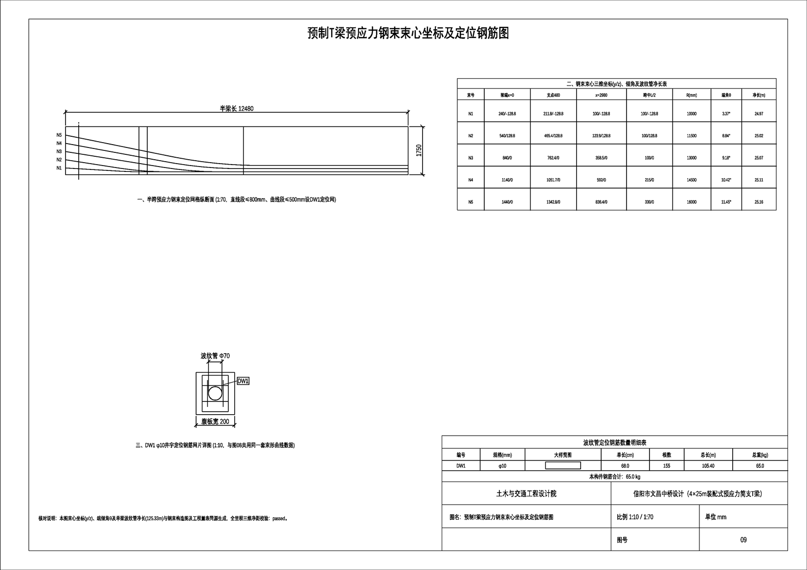<br/>
      <sub><b>Sheet 09 · 3D Tendon Coordinates &amp; Positioning Mesh</b> — Spatial y/z coordinate schedule, end angles, net duct lengths &amp; <code>DW1</code> rebar detail</sub>
    </td>
    <td width="50%" align="center">
      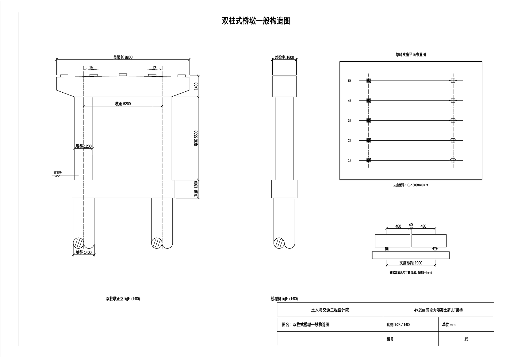<br/>
      <sub><b>Sheet 15 · Double-Column Pier General Layout</b> — Twin columns, tie beam &amp; piles sharing the exact <code>480+40+480=1000 mm</code> support chain with Sheets 06/13</sub>
    </td>
  </tr>
</table>

<details>
<summary><b>🔩 View Substructure Joint Rebar Detail Example (Sheet 19-1 Pile-Top Tie-Beam &amp; Joint Anchorage)</b></summary>
<br/>
<p align="center">
  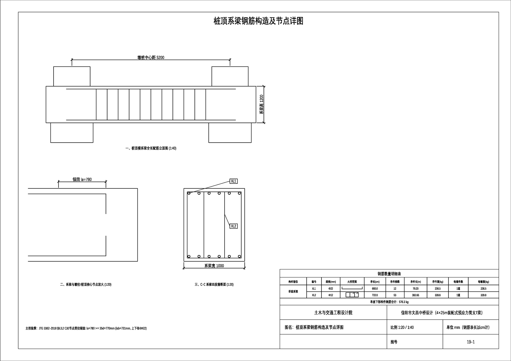<br/>
  <sub><b>Sheet 19-1 · Pile-Top Tie-Beam Rebar &amp; Joint Detail</b> — Full-length elevation, joint tension anchorage detail (<code>la=780 mm ≥ 35d</code>), 4-leg stirrup section, and synchronized rebar BOQ.</sub>
</p>
</details>

### 3. 300-DPI Word Thesis & Oral-Defense Calculation Figures

<p align="center">
  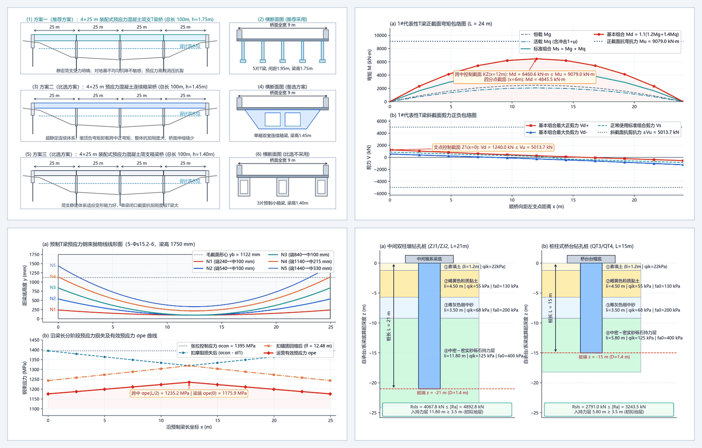<br/>
  <sub><b>Auto-Generated 300-DPI Calculation Figures</b> — Top-Left: 3-scheme bridge elevation &amp; cross-section comparison · Top-Right: Governing M &amp; V envelopes · Bottom-Left: Parabolic tendon profiles &amp; effective prestress curve · Bottom-Right: Pier (21 m) vs. abutment (15 m) stratified pile-soil profiles</sub>
</p>

### 4. Interactive Web Studio Bridge Workbench & Marquee Revision UI

The built-in **Web Studio (`/studio`)** includes a dedicated **`5. 🌉 土木桥梁` (Civil & Bridge)** workbench alongside **`6. ✏️ 局部精改` (Surgical Revision)** and the in-chat **MCP Review Pane (`cad_open_viewer`)**:

<p align="center">
  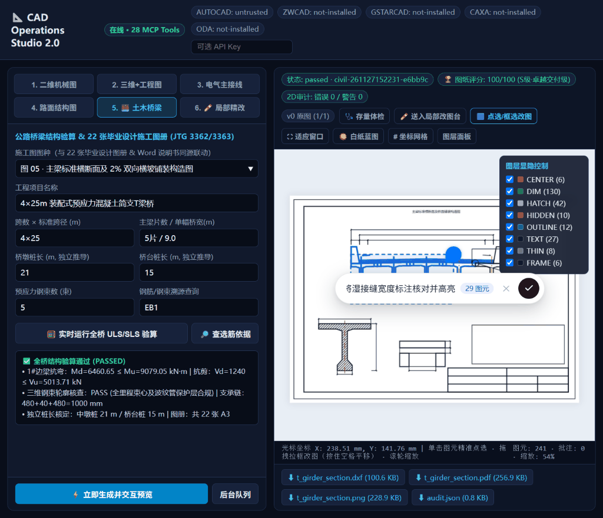<br/>
  <sub><b>Web Studio <code>5. 🌉 土木桥梁</code> Interactive Workbench</b> — Left: Live bridge-wide ULS/SLS verification, 3D tendon clearance check &amp; 6-field rebar provenance lookup (<code>EB1</code> / <code>N4</code>); Right: Zoomable vector blueprint canvas with layer toggles and a floating <b>blue-dashed marquee region revision pill</b></sub>
</p>

<p align="center">
  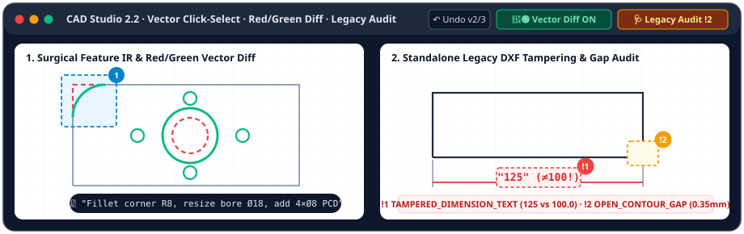<br/>
  <sub><b>Surgical Diff &amp; Legacy Audit UI</b> — Left: Point-click / marquee surgical revision with live <b>Red/Green Vector Diff</b> &amp; Undo/Redo · Right: <b>Legacy DXF Tampering <code>!1</code> &amp; Micro-Gap <code>!2</code> Audit</b></sub>
</p>

---

## What You Can Do

- **[Deliver Complete Civil & Bridge Graduation / Construction Suites](references/civil-bridge-engineering.md)**: Generate all **22 A3 CAD sheets (DXF + bookmarked PDF + PNG), 6 300-DPI calculation figures, and a college-template `.docx` thesis** in one command—with strict Dr.Bridge/Midas FEM verification and automatic `.docx`/`.dxf` style learning.
- **[Draft Audited 2D & 3D Mechanical/Electrical/Municipal Deliverables](#core-modules)**: Compile briefs or tables into 3-view GB/T & ISO drawings (with native `Ra` surface roughness, `[A]/[B]` datums, GD&T frames, and auto-collision repair) plus watertight `.step` / `.glb` / `.stl` solids.
- **[Revise Surgically with Red/Green Vector Diff](#core-modules)**: Click exact entities or drag a marquee box to resize holes, **chamfer (`C5`)**, **fillet (`R8`)**, **add bolt-circle patterns (`PCD`)**, or **mirror**—verified atomically so out-of-scope dimensions (like `120` vs `Ø12`) are never corrupted.
- **[Audit & Clean Wild Legacy DXFs](#core-modules)**: Detect manually tampered dimensions (`"125"` written over an `100.0 mm` line), exploded fake dimensions, `0.35 mm` open contour CAM gaps, duplicate lines, and text-line collisions—with one-click deterministic cleanup.
- **[Connect Any AI Agent or Team via 28 MCP Tools & Web Studio](#mcp--agent-integration)**: Expose 28 strict-schema MCP tools (`stdio` + HTTP), project & template memory (`.cad-memory/`), failure-to-regression flywheel, and an interactive HTML5 vector CAD workstation.

### Generate a full 22-sheet highway bridge suite + Word thesis in one command:

```powershell
# 1. Zero-config: 22 A3 CAD sheets + bookmarked PDF album + 6 300-DPI figures + formal Word thesis (.docx)
python scripts/run_bridge_suite.py --out output/wenchang_22_suite

# 2. Auto-learn university .docx & sample .dxf styles + verify against Dr.Bridge FEM & 3D tendon model
python scripts/run_bridge_suite.py --out output/custom_suite `
  --learn-docx ref_thesis.docx --learn-dxf ref_dxf_dir `
  --fem-results fem_super.json --substructure-fem fem_sub.json --drbridge-tendon-model new.txt
```

### Audit & surgically revise a legacy DXF in 8 lines of Python:

```python
from cad_skill_core.inspection import audit_legacy_dxf, clean_legacy_dxf
from cad_skill_core.revision.nl_revise import execute_nl_region_revision

# 1. Catch tampered dimensions, open CAM micro-gaps & duplicates on any external DXF
report = audit_legacy_dxf("incoming_vendor.dxf")
clean_legacy_dxf("incoming_vendor.dxf", "cleaned.dxf", close_micro_gaps_tol=0.6)

# 2. Apply unit-aware surgical feature edit (guaranteed zero out-of-scope mutation!)
res = execute_nl_region_revision("cleaned.dxf", "out_rev", "全部四个角倒圆角 R5", candidate_handles=["1A"])
print(res["summary_zh"], "-> Touched:", res["modified_handles"])
```

### Or launch the interactive Web Studio & HTTP MCP Gateway:

```powershell
$env:PYTHONPATH = "runtime/cad-2d-skill/src"
python -B -m cad_skill_core.cli mcp-http --host 127.0.0.1 --port 8765 --workspace output/mcp_workspace
# Open http://127.0.0.1:8765/studio in your browser!
```

---

## Core Modules

<table>
  <tr>
    <td width="236" align="center">
      
    </td>
    <td>
      <b>Civil &amp; Highway Bridge Engineering Suite</b> — End-to-end JTG hydrology, lateral distribution, prestress loss, 3D tendon clearance audit, 2D planar frame substructure solver, strict Dr.Bridge/Midas verification, automatic <code>.docx/.dxf</code> template learning, Word thesis assembly, and 22-sheet A3 CAD albums. <a href="references/civil-bridge-engineering.md">Docs →</a>
    </td>
  </tr>
  <tr>
    <td width="236" align="center">
      
    </td>
    <td>
      <b>GB/T &amp; ISO 2D Parametric Drafting Engine</b> — Compiles <code>.md</code> / <code>.docx</code> / <code>.pdf</code> / <code>.csv</code> specs, blocks missing or conflicting dimensions, and renders spur gears, bearing caps, ribbed brackets, flanges, shafts, electrical SLDs &amp; pavement sections with vector <code>Ra</code>, datums, GD&amp;T leaders, and 100-point rubric scoring.
    </td>
  </tr>
  <tr>
    <td width="236" align="center">
      
    </td>
    <td>
      <b>Structured Revision IR (<code>v2</code>) &amp; Red/Green Vector Diff</b> — Bridges LLM/Agent intents into deterministic transactions (<code>add_circle_hole</code>, <code>add_bolt_circle</code>, <code>chamfer_corner</code>, <code>fillet_corner</code>, <code>mirror_entities</code>, hole/span resize) with <code>$INSUNITS</code> scaling, <code>compare_untouched</code> rollback, and live red/green overlay diff. <a href="references/revision-tools.md">Docs →</a>
    </td>
  </tr>
  <tr>
    <td width="236" align="center">
      
    </td>
    <td>
      <b>Standalone Legacy DXF Tampering &amp; Topology Auditor</b> — Zero internal spec required. Flags manually falsified dimension overrides (<code>TAMPERED_DIMENSION_TEXT</code>), exploded annotations, open contour micro-gaps blocking laser/CNC CAM, duplicate entities, and text collisions—plus atomic auto-cleaning.
    </td>
  </tr>
  <tr>
    <td width="236" align="center">
      
    </td>
    <td>
      <b>Watertight 3D Manifold Kernel &amp; 3D→2D Projection</b> — Generates verified watertight 3D mechanical solids (full-tooth gears with keyways, stepped chambers, stiffened brackets, compound bosses/counterbores), exports <b>ISO 10303-21 <code>.step</code></b> / <code>.glb</code> / <code>.stl</code> / <code>.obj</code>, and projects multi-view 2D sheets.
    </td>
  </tr>
  <tr>
    <td width="236" align="center">
      
    </td>
    <td>
      <b>Authenticode-Verified Native CAD Drivers</b> — Discovers and drives headless <b>AutoCAD 2021–2026</b>, <b>ZWCAD</b>, <b>GstarCAD</b>, <b>CAXA</b>, and <b>ODA File Converter</b> with allowlisted ACIS <code>3DSOLID</code> scripts and lossless <code>DWG ↔ DXF</code> structural round-trip verification.
    </td>
  </tr>
  <tr>
    <td width="236" align="center">
      
    </td>
    <td>
      <b>28-Tool MCP Server &amp; Interactive Web Studio</b> — Plugs directly into Claude Code, Cursor, Codex, and Antigravity via <code>stdio</code> or HTTP with path-traversal sandboxing, DXF-bomb guards, live Civil &amp; Bridge workbench, hover-snap vector picking, marquee prompt pill, and Undo/Redo. <a href="references/mcp-server-guide.md">Guide →</a>
    </td>
  </tr>
</table>

---

## Quick Start

### 1. Installation (Python 3.12+)

```powershell
git clone https://github.com/XiaoGuai23/cad-operations-skill.git
cd cad-operations-skill
py -3.12 -m venv .venv
.\.venv\Scripts\python.exe -m pip install -r requirements.txt -e "./runtime/cad-2d-skill[dev]"
```

### 2. Run Verification Suite (`1,059+` Automated Tests)

```powershell
python tests/smoke_test.py
$env:PYTHONPATH = "runtime/cad-2d-skill/src;runtime/cad-2d-skill"
python -m pytest runtime/cad-2d-skill/tests -q -m "not autocad"
```

---

## MCP & Agent Integration

Add **CAD Operations Skill** to your `claude_desktop_config.json`, `.cursor/mcp.json`, or Antigravity MCP config:

```json
{
  "mcpServers": {
    "cad-operations": {
      "command": "python",
      "args": [
        "-B", "-m", "cad_skill_core.cli", "mcp-stdio",
        "--workspace", "./output/mcp_workspace"
      ],
      "env": {
        "PYTHONPATH": "./runtime/cad-2d-skill/src",
        "PYTHONUTF8": "1"
      }
    }
  }
}
```

<details>
<summary><b>🛠️ View CLI Workflow Cheatsheet (Bridge / 2D / 3D / Style Learner / Benchmark)</b></summary>

```powershell
# Compile engineering brief -> DrawingSpec & auto-learn .docx + .dxf template styles
python -m cad_skill_core compile-spec examples/project_brief.md --out output/drawing-spec.json --json
python -m cad_skill_core learn-template --docx ref_thesis.docx --dxf ref_dxf_dir --out .cad-memory --json

# Generate watertight 3D model (.step/.glb/.stl) + projected GB/T 2D engineering sheet
python -m cad_skill_core generate-3d model3d-spec.json --out output/part3d --with-2d-sheet --json

# Probe local AutoCAD / ZWCAD / GstarCAD / ODA drivers & verify DWG <-> DXF round-trip
python -m cad_skill_core drivers --json
python -m cad_skill_core verify-roundtrip before.dxf after.dxf --json

# Score any DXF on the 100-point GB/T & ISO rubric or run the offline CAD-1K benchmark
python -m cad_skill_core score-drawing output/part3d/sheet2d.dxf --json
python -m cad_skill_core benchmark-cad1k --out output/cad1k-eval --json

# Electrical substation SLD, road pavement & 22-sheet A3 bridge suite + Word graduation thesis
python scripts/make_main_sld.py examples/electrical_sld_spec.json --outdir output/sld --stem demo_sld
python scripts/generate_pavement_cad_ezdxf.py examples/pavement_structure_spec.json --out output/pavement
python scripts/run_bridge_suite.py --out output/wenchang_22_sheets
```
</details>

---

## Architecture Overview

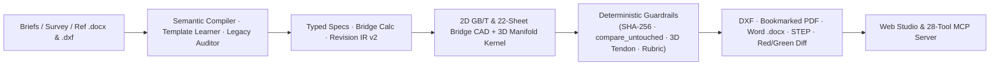

---

## Star History

<div align="center">
  <a href="https://star-history.com/#XiaoGuai23/cad-operations-skill&Date">
    <picture>
      <source media="(prefers-color-scheme: dark)" srcset="https://api.star-history.com/svg?repos=XiaoGuai23/cad-operations-skill&type=Date&theme=dark">
      <source media="(prefers-color-scheme: light)" srcset="https://api.star-history.com/svg?repos=XiaoGuai23/cad-operations-skill&type=Date">
      
    </picture>
  </a>
</div>

---

## License & Credits

Released under the [MIT License](LICENSE). Originally evolved from [2836048681/cad-operations-skill](https://github.com/2836048681/cad-operations-skill); third-party notices for adapted `ezdxf` rendering utilities are documented in [THIRD_PARTY_NOTICES.md](runtime/cad-2d-skill/THIRD_PARTY_NOTICES.md). Native `.dwg` conversion and ACIS solid execution invoke locally installed, signature-verified CAD consoles and do not bundle proprietary CAD binaries or fonts.
