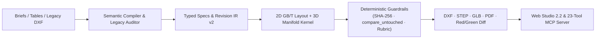

<div align="center">

<picture>
  <source media="(prefers-color-scheme: dark)" srcset="assets/hero-dark.svg">
  <source media="(prefers-color-scheme: light)" srcset="assets/hero-light.svg">
  
</picture>

<h3>Effortless, Zero-Hallucination 2D &amp; 3D CAD Automation for AI Agents</h3>

<!-- Language Switcher Pills -->
<p>
  <a href="README.md"></a>
  <a href="README_ZH.md"></a>
</p>

<!-- Primary Status & Capability Badges -->
<p>
  <a href="https://github.com/XiaoGuai23/cad-operations-skill/actions/workflows/smoke-test.yml"></a>
  <a href="https://github.com/XiaoGuai23/cad-operations-skill/releases"></a>
  
  
  <a href="references/mcp-server-guide.md"></a>
  <a href="SKILL.md"></a>
  <a href="LICENSE"></a>
</p>

<p>
  
  
</p>

<!-- Quick Anchor Navigation Bar -->
<p>
  <a href="#visual-showcase"><b>Visual Showcase</b></a> ·
  <a href="#what-you-can-do"><b>What You Can Do</b></a> ·
  <a href="#core-modules"><b>Core Modules</b></a> ·
  <a href="#quick-start"><b>Quick Start</b></a> ·
  <a href="#mcp--agent-integration"><b>MCP &amp; Agents</b></a> ·
  <a href="README_ZH.md"><b>中文文档</b></a>
</p>

</div>

---

**CAD Operations Skill** is an industrial-grade 2D & 3D CAD generation, surgical revision, and engineering audit engine built for AI coding agents (**Claude Code, Cursor, Codex, Antigravity**) and automated engineering pipelines.

Compile `.docx` / `.pdf` / `.md` specifications into collision-free **GB/T & ISO blueprints**, build watertight **3D STEP/GLB solids**, inspect wild legacy DXFs for **tampered dimensions & micro-gaps**, and revise exact entities through **point-click / marquee Red-Green Vector Diff**—all protected by SHA-256 hash locks and `compare_untouched` out-of-scope guardrails.

Use it from **Python**, the **CLI**, the built-in **Web Studio 2.2** (`/studio`), or connect any AI agent via its **23-tool MCP Server** (`stdio` & Streamable HTTP).

---

## Visual Showcase

<table>
  <tr>
    <td width="50%" align="center">
      <br/>
      <sub><b>3D Mechanical Assembly</b> — Multi-part drilling jig solid model</sub>
    </td>
    <td width="50%" align="center">
      <br/>
      <sub><b>Matched GB/T 2D Assembly Sheet</b> — <code>A-A</code> section hatching, leader balloons &amp; 10-row bottom-up BOM</sub>
    </td>
  </tr>
  <tr>
    <td width="50%" align="center">
      <br/>
      <sub><b>Multi-Plate Die Tooling</b> — Color-coded 12-component progressive die STEP assembly</sub>
    </td>
    <td width="50%" align="center">
      <br/>
      <sub><b>Downstream CAM Ready</b> — Watertight B-Rep/STEP geometry feeding directly into CNC toolpaths</sub>
    </td>
  </tr>
</table>

<p align="center">
  <br/>
  <sub><b>Web Studio 2.2</b> — Left: Point-click / marquee surgical revision with live <b>Red/Green Vector Diff</b> &amp; Undo/Redo · Right: <b>Legacy DXF Tampering &amp; Micro-Gap Audit</b></sub>
</p>

<details>
<summary><b>📐 View Full-Sheet Municipal &amp; Process Elevation Blueprint Example</b> (Click to expand)</summary>
<br/>
<p align="center">
  <br/>
  <sub>Multi-domain drafting coverage across mechanical parts/assemblies, substation single-line diagrams (SLD), pavement cross-sections, and municipal process sheets.</sub>
</p>
</details>

---

## What You Can Do

- **[Draft Audited 2D & 3D Engineering Deliverables](#core-modules)**: Compile briefs or tables into 3-view GB/T & ISO drawings (with native `Ra` surface roughness, `[A]/[B]` datums, GD&T frames, and auto-collision repair) plus watertight `.step` / `.glb` / `.stl` solids.
- **[Revise Surgically with Red/Green Vector Diff](#core-modules)**: Click exact entities or drag a marquee box to resize holes, **chamfer (`C5`)**, **fillet (`R8`)**, **add bolt-circle patterns (`PCD`)**, or **mirror**—verified atomically so out-of-scope dimensions (like `120` vs `Ø12`) are never corrupted.
- **[Audit & Clean Wild Legacy DXFs](#core-modules)**: Detect manually tampered dimensions (`"125"` written over an `100.0 mm` line), exploded fake dimensions, `0.35 mm` open contour CAM gaps, duplicate lines, and text-line collisions—with one-click deterministic cleanup.
- **[Civil & Highway Bridge Calculation + CAD Suite (`v2.4`)](references/civil-bridge-engineering.md)**: Zero-dependency structural processor (Manning hydrology, exact polygonal/T-girder section properties, Lever/Courbon lateral load distribution, Highway-I 10-element $M/Q$ envelopes, prestress losses, 1D cap-beam FEM, and cross-sheet/table QA auditor) + 5 audited bridge CAD sheets (`ARCHTICK`, pile S-breaks, ground lines, bearing symbols).
- **[Connect Any AI Agent or Team via MCP & Web Studio](#mcp--agent-integration)**: Expose 28 strict-schema MCP tools (`stdio` + HTTP), project preference memory, failure-to-regression flywheel, and an interactive HTML5 vector CAD workstation.

### Audit & surgically revise a legacy DXF in 8 lines of Python:

```python
from cad_skill_core.inspection import audit_legacy_dxf, clean_legacy_dxf
from cad_skill_core.revision.nl_revise import execute_nl_region_revision

# 1. Catch tampered dimensions, open CAM micro-gaps & duplicates on any external DXF
report = audit_legacy_dxf("incoming_vendor.dxf")
clean_legacy_dxf("incoming_vendor.dxf", "cleaned.dxf", close_micro_gaps_tol=0.6)

# 2. Apply unit-aware surgical feature edit (guaranteed zero out-of-scope mutation!)
res = execute_nl_region_revision("cleaned.dxf", "out_rev", "全部四个角倒圆角 R5", candidate_handles=["1A"])
print(res["summary_zh"], "-> Touched:", res["modified_handles"])
```

### Or launch the interactive Web Studio 2.2 & HTTP MCP Gateway:

```powershell
$env:PYTHONPATH = "runtime/cad-2d-skill/src"
python -B -m cad_skill_core.cli mcp-http --host 127.0.0.1 --port 8765 --workspace output/mcp_workspace
# Open http://127.0.0.1:8765/studio in your browser!
```

---

## Core Modules

<table>
  <tr>
    <td width="236" align="center">
      
    </td>
    <td>
      <b>GB/T &amp; ISO 2D Parametric Drafting Engine</b> — Compiles <code>.md</code> / <code>.docx</code> / <code>.pdf</code> / <code>.csv</code> specs, blocks missing or conflicting dimensions, and renders spur gears, bearing caps, ribbed brackets, flanges, shafts, electrical SLDs &amp; pavement sections with vector <code>Ra</code>, datums, GD&amp;T leaders, and 100-point rubric scoring.
    </td>
  </tr>
  <tr>
    <td width="236" align="center">
      
    </td>
    <td>
      <b>Structured Revision IR (<code>v2</code>) &amp; Red/Green Vector Diff</b> — Bridges LLM/Agent intents into deterministic transactions (<code>add_circle_hole</code>, <code>add_bolt_circle</code>, <code>chamfer_corner</code>, <code>fillet_corner</code>, <code>mirror_entities</code>, hole/span resize) with <code>$INSUNITS</code> scaling, <code>compare_untouched</code> rollback, and live red/green overlay diff. <a href="references/revision-tools.md">Docs →</a>
    </td>
  </tr>
  <tr>
    <td width="236" align="center">
      
    </td>
    <td>
      <b>Standalone Legacy DXF Tampering &amp; Topology Auditor</b> — Zero internal spec required. Flags manually falsified dimension overrides (<code>TAMPERED_DIMENSION_TEXT</code>), exploded annotations, open contour micro-gaps blocking laser/CNC CAM, duplicate entities, and text collisions—plus atomic auto-cleaning.
    </td>
  </tr>
  <tr>
    <td width="236" align="center">
      
    </td>
    <td>
      <b>Watertight 3D Manifold Kernel &amp; 3D→2D Projection</b> — Generates verified watertight 3D mechanical solids (full-tooth gears with keyways, stepped chambers, stiffened brackets, compound bosses/counterbores), exports <b>ISO 10303-21 <code>.step</code></b> / <code>.glb</code> / <code>.stl</code> / <code>.obj</code>, and projects multi-view 2D sheets.
    </td>
  </tr>
  <tr>
    <td width="236" align="center">
      
    </td>
    <td>
      <b>Authenticode-Verified Native CAD Drivers</b> — Discovers and drives headless <b>AutoCAD 2021–2026</b>, <b>ZWCAD</b>, <b>GstarCAD</b>, <b>CAXA</b>, and <b>ODA File Converter</b> with allowlisted ACIS <code>3DSOLID</code> scripts and lossless <code>DWG ↔ DXF</code> structural round-trip verification.
    </td>
  </tr>
  <tr>
    <td width="236" align="center">
      
    </td>
    <td>
      <b>23-Tool MCP Server &amp; Interactive Web Studio 2.2</b> — Plugs directly into Claude Code, Cursor, Codex, and Antigravity via <code>stdio</code> or HTTP with path-traversal sandboxing, DXF-bomb guards, hover-snap vector picking, pin secondary editing, and multi-step Undo/Redo. <a href="references/mcp-server-guide.md">Guide →</a>
    </td>
  </tr>
</table>

---

## Quick Start

### 1. Installation (Python 3.12+)

```powershell
git clone https://github.com/XiaoGuai23/cad-operations-skill.git
cd cad-operations-skill
py -3.12 -m venv .venv
.\.venv\Scripts\python.exe -m pip install -r requirements.txt -e "./runtime/cad-2d-skill[dev]"
```

### 2. Run Verification Suite (`1,024+` Automated Tests)

```powershell
python tests/smoke_test.py
$env:PYTHONPATH = "runtime/cad-2d-skill/src;runtime/cad-2d-skill"
python -m pytest runtime/cad-2d-skill/tests -q -m "not autocad"
```

---

## MCP & Agent Integration

Add **CAD Operations Skill** to your `claude_desktop_config.json`, `.cursor/mcp.json`, or Antigravity MCP config:

```json
{
  "mcpServers": {
    "cad-operations": {
      "command": "python",
      "args": [
        "-B", "-m", "cad_skill_core.cli", "mcp-stdio",
        "--workspace", "./output/mcp_workspace"
      ],
      "env": {
        "PYTHONPATH": "./runtime/cad-2d-skill/src",
        "PYTHONUTF8": "1"
      }
    }
  }
}
```

<details>
<summary><b>🛠️ View CLI Workflow Cheatsheet (2D / 3D / Drivers / Benchmark)</b></summary>

```powershell
# Compile engineering brief -> DrawingSpec & learn layer/dim style from a sample DXF
python -m cad_skill_core compile-spec examples/project_brief.md --out output/drawing-spec.json --json
python -m cad_skill_core learn-standard sample.dxf --out output/custom-standard.yaml --json

# Generate watertight 3D model (.step/.glb/.stl) + projected GB/T 2D engineering sheet
python -m cad_skill_core generate-3d model3d-spec.json --out output/part3d --with-2d-sheet --json

# Probe local AutoCAD / ZWCAD / GstarCAD / ODA drivers & verify DWG <-> DXF round-trip
python -m cad_skill_core drivers --json
python -m cad_skill_core verify-roundtrip before.dxf after.dxf --json

# Score any DXF on the 100-point GB/T & ISO rubric or run the offline CAD-1K benchmark
python -m cad_skill_core score-drawing output/part3d/sheet2d.dxf --json
python -m cad_skill_core benchmark-cad1k --out output/cad1k-eval --json

# Electrical substation SLD & road pavement cross-section generators
python scripts/make_main_sld.py examples/electrical_sld_spec.json --outdir output/sld --stem demo_sld
python scripts/generate_pavement_cad_ezdxf.py examples/pavement_structure_spec.json --out output/pavement
```
</details>

---

## Architecture Overview



---

## Star History

<div align="center">
  <a href="https://star-history.com/#XiaoGuai23/cad-operations-skill&Date">
    <picture>
      <source media="(prefers-color-scheme: dark)" srcset="https://api.star-history.com/svg?repos=XiaoGuai23/cad-operations-skill&type=Date&theme=dark">
      <source media="(prefers-color-scheme: light)" srcset="https://api.star-history.com/svg?repos=XiaoGuai23/cad-operations-skill&type=Date">
      
    </picture>
  </a>
</div>

---

## License & Credits

Released under the [MIT License](LICENSE). Originally evolved from [2836048681/cad-operations-skill](https://github.com/2836048681/cad-operations-skill); third-party notices for adapted `ezdxf` rendering utilities are documented in [THIRD_PARTY_NOTICES.md](runtime/cad-2d-skill/THIRD_PARTY_NOTICES.md). Native `.dwg` conversion and ACIS solid execution invoke locally installed, signature-verified CAD consoles and do not bundle proprietary CAD binaries or fonts.
