<div align="center">

<picture>
  <source media="(prefers-color-scheme: dark)" srcset="assets/hero-dark.svg">
  <source media="(prefers-color-scheme: light)" srcset="assets/hero-light.svg">
  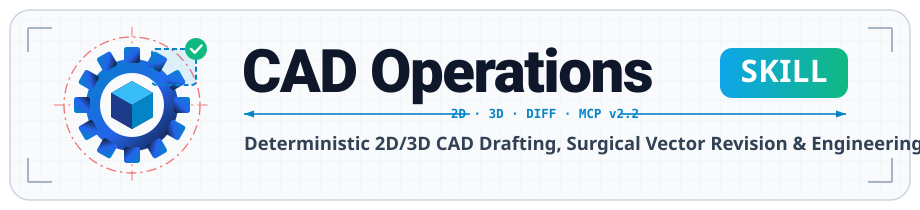
</picture>

<h3>面向 AI 智能体的零幻觉二维/三维 CAD 自动出图、土木桥梁全套毕设/施工图与矢量精改平台</h3>

<!-- 语言切换胶囊 -->
<p>
  <a href="README.md"></a>
  <a href="README_ZH.md"></a>
</p>

<!-- 状态与核心能力徽章墙 -->
<p>
  <a href="https://github.com/XiaoGuai23/cad-operations-skill/actions/workflows/smoke-test.yml"></a>
  <a href="https://github.com/XiaoGuai23/cad-operations-skill/releases"></a>
  
  
  <a href="references/mcp-server-guide.md"></a>
  <a href="SKILL.md"></a>
  <a href="LICENSE"></a>
</p>

<p>
  
  
</p>

<!-- 快捷锚点导航 -->
<p>
  <a href="#%E5%AE%9E%E6%99%AF%E6%A1%88%E4%BE%8B%E7%94%BB%E5%BB%8A"><b>实景案例画廊</b></a> ·
  <a href="#%E5%9C%9F%E6%9C%A8%E4%B8%8E%E5%85%AC%E8%B7%AF%E6%A1%A5%E6%A2%81%E5%8F%AF%E5%88%B6%E4%BD%9C%E6%88%90%E6%9E%9C%E4%B8%8E%E4%BA%A4%E4%BA%92-ui"><b>🌉 土木桥梁专栏</b></a> ·
  <a href="#%E4%BD%A0%E5%8F%AF%E4%BB%A5%E7%94%A8%E5%AE%83%E5%81%9A%E4%BB%80%E4%B9%88"><b>核心用法</b></a> ·
  <a href="#%E4%B8%83%E5%A4%A7%E6%A0%B8%E5%BF%83%E5%BC%95%E6%93%8E"><b>七大核心引擎</b></a> ·
  <a href="#%E5%BF%AB%E9%80%9F%E5%BC%80%E5%A7%8B"><b>快速开始</b></a> ·
  <a href="#mcp-%E4%B8%8E%E6%99%BA%E8%83%BD%E4%BD%93%E6%8E%A5%E5%85%A5"><b>MCP 接入</b></a> ·
  <a href="README.md"><b>English</b></a>
</p>

</div>

---

**CAD Operations Skill** 是一套专为 AI 编程智能体（**Claude Code、Cursor、Codex、Antigravity**）及工程自动化管线打造的 **二维 + 三维全闭环 CAD 智能制图、土木桥梁全链路设计、受控局部精改与存量图纸体检平台**。

它不仅能将 `.docx` / `.pdf` / `.md` 项目书自动编译为**零压线的国标（GB/T）与 ISO 二维工程图**、**水密流形三维 `.step` / `.glb` 模型**，以及**全套 22 张 A3 公路桥梁施工图册 + 学院模板正式 Word 毕业设计说明书**，还能自动学习参考 `.docx` / `.dxf` 模板样式，并通过 **Web Studio 交互工作台**与 **28 项强校验 MCP 工具**实现矢量点选、“圈哪改哪”局部修订与红绿叠图 Diff。

---

## 实景案例画廊

<table>
  <tr>
    <td width="50%" align="center">
      <br/>
      <sub><b>三维机械夹具总装模型</b> — 导向支架钻孔夹具多零件装配实体</sub>
    </td>
    <td width="50%" align="center">
      <br/>
      <sub><b>1:1 联动国标二维总装工程图</b> — <code>A-A</code> 全剖剖面线、序号指引线与自下而上 10 行国标明细表</sub>
    </td>
  </tr>
  <tr>
    <td width="50%" align="center">
      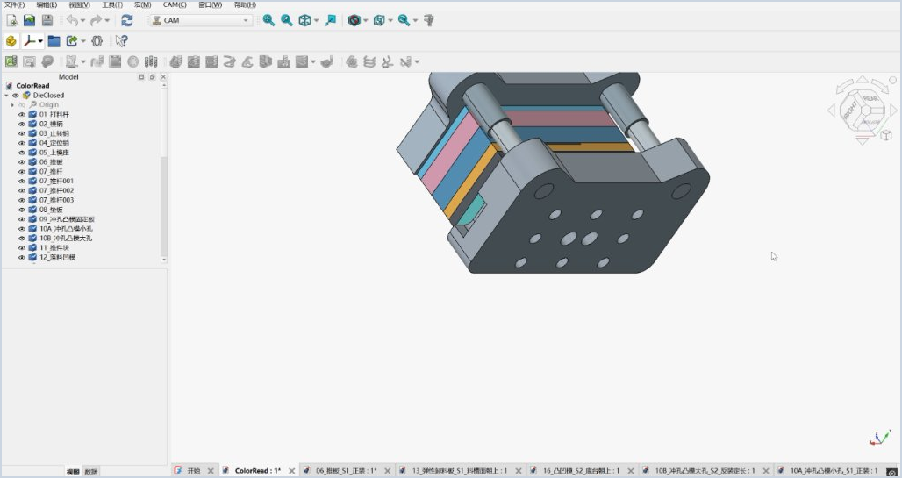<br/>
      <sub><b>多板冲压模具三维装配</b> — 12 组件彩色分层 STEP 装配结构树</sub>
    </td>
    <td width="50%" align="center">
      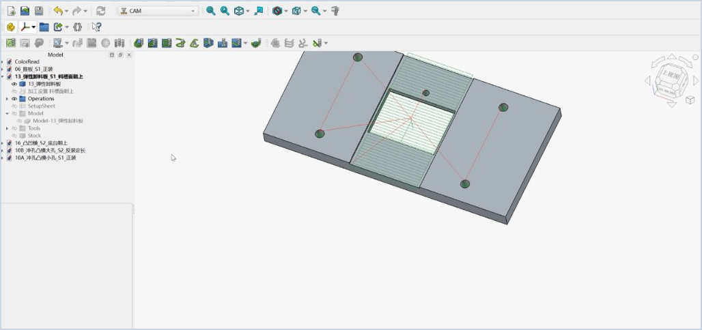<br/>
      <sub><b>下游 CNC CAM 刀路直连</b> — 水密流形实体无缝导入 CAM 生成铣削与钻孔刀路</sub>
    </td>
  </tr>
</table>

<details>
<summary><b>📐 展开查看：市政污水处理厂全厂水力及污泥流程高程布置图示例</b></summary>
<br/>
<p align="center">
  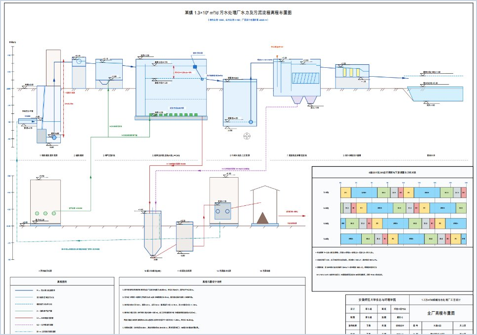<br/>
  <sub>覆盖机械零件与夹具总装、公路桥梁全套施工图、变电站电气主接线图（SLD）、道路沥青路面结构图与市政工艺高程图等多专业制图场景。</sub>
</p>
</details>

---

## 土木与公路桥梁可制作成果与交互 UI

面向**土木工程（道路与桥梁方向）毕业设计、课程设计与中小跨径公路桥梁施工图设计**，本技能严格遵循 `JTG D60-2015`、`JTG 3362-2018`、`JTG 3363-2019`、`JT/T 4-2019` 规范，内置从**水文地勘接入 → 上下部结构计算 → 独立电算核对 → 22 张 A3 施工图册 → 正式 Word 论文**的一体化流水线（详见 [土木与桥梁工程指南](references/civil-bridge-engineering.md)）：

### 1. 可直接生成的五大类桥梁工程成果

| 成果类别 | 可制作的具体内容与核心工程特性 | 输出格式 |
| :--- | :--- | :--- |
| **① 全套 22 张 A3 桥梁施工图册**（兼容 18 张 `QL` 编号） | 完整覆盖任务书 **9 大类图纸**：`01` 设计总说明与目录、`02` 全桥工程量总表、`03/04` 桥型总体立面/平面（含实测洪水位与中墩 `21 m` / 桥台 `15 m` 独立桩长）、`05` `2%` 双向横坡标准横断面（薄层梳状引线 + 湿接缝详图）、`06/07` 预制 `C50` T 梁一般构造、`08/09` 预应力钢束及**三维束心坐标与 `DW1` 定位钢筋网**、`10～12` 梁肋/翼缘/横隔梁普通钢筋、`13/14` 板式橡胶支座垫石与桥面系、`15/16` 双柱墩与桩柱式桥台构造（共用 **`480+40+480=1000 mm`** 支承尺寸链）、`17～21` 盖梁/挡块（`DK1`）/**桩顶系梁节点 `19-1`**/桥台耳背墙展开（`EB1～EB3`）。每张图均经重开 DXF 实测几何与零文字重叠核验。 | `.dxf` · 带书签合并打印 `.pdf` · `.png` |
| **② 6 幅论文与答辩 PPT 高清计算插图** | 同桥位三桥型方案立面及横断面对比图（简支 T 梁 / 连续箱梁 / 简支小箱梁）、边/中梁带尺寸截面详图、结构计算简图、代表梁弯矩与剪力组合包络图、预应力钢束线形及沿程有效预应力曲线、中墩与桥台钻孔桩分层地层对比图。 | `300 DPI .png` · 矢量 `.svg` |
| **③ 学院模板正式毕业设计说明书与计算书** | 默认零隐私封面、中英文摘要、**三级书签超链接目录**、11 章完整公式代入推导、防跨页断行自动“续表”三线表、**12 篇中英文双口径正文实引文献**，以及任一钢筋/钢束编号（如 `N4`、`DW1`、`XL1`、`EB1`）**6 维选筋溯源总表**。 | `.docx` · `.md` · `.json` |
| **④ 桥梁博士（Dr.Bridge）/ Midas 电算逐项复核与三维净距拦截** | 支持导入上下部分册电算表与 `new.txt` 空间坐标：按构件、截面、荷载组合逐项比对（**严防“运营标准值”混入“基本组合”**，缺项诚实标注 `部分核对`）；逐里程核查三维束心与波纹管保护层（自动拦截如 **`N4` 在 `x=2980 mm` 处越出腹板 `10 mm`** 的隐患），内置二维平面刚架刚度矩阵 `[K]{u}={F}` 复核盖梁/墩柱/系梁内力。 | 电算对照三线表 · 越界审计 JSON |
| **⑤ 参考 `.docx` / `.dxf` 模板自动学习与变更影响追踪** | 传入任意院校参考论文 `.docx` 与设计院参考 `.dxf`，自动提取标题字号、页边距、三线表与 CAD 图层线宽字高存入 `.cad-memory/`；修改跨径、桩长或钢束后，基于 DXF 语义指纹精准列出受影响章节与图号（参数不变重跑严格 0 误报）。 | `.cad-memory/*.json` · `change_impact_report.json` |

### 2. 毕业设计施工图册代表样图展示（`4×25 m` 预应力混凝土简支 T 梁桥）

<table>
  <tr>
    <td width="50%" align="center">
      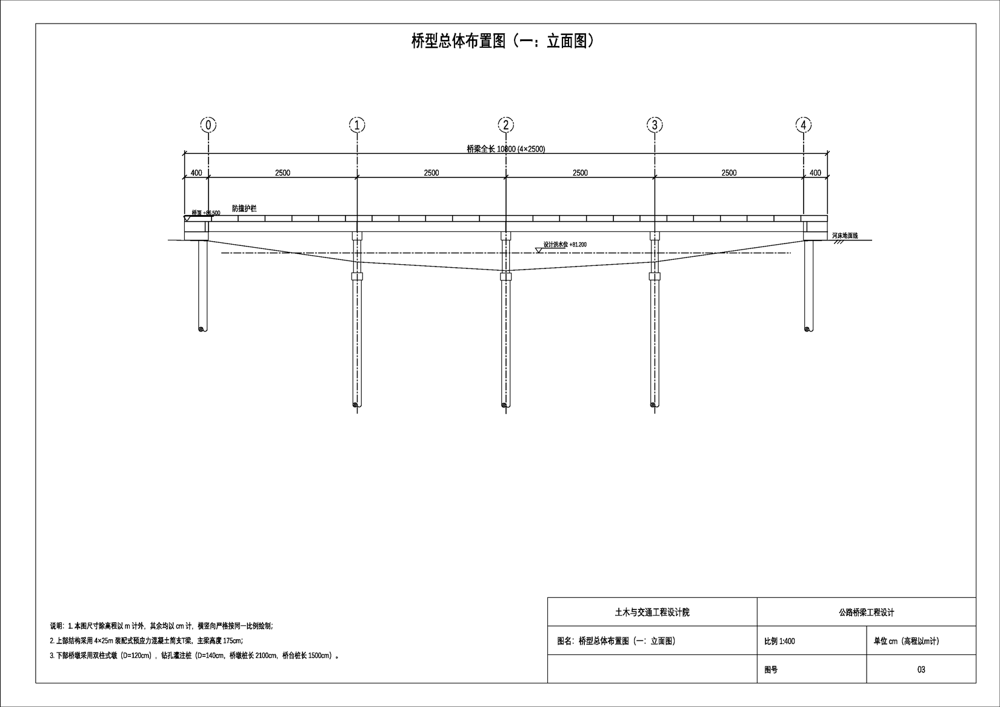<br/>
      <sub><b>图 03 · 桥型总体布置图（1:400 立面）</b> — 4×25 m 跨径链、设计洪水位及中墩 21 m / 桥台 15 m 独立桩长</sub>
    </td>
    <td width="50%" align="center">
      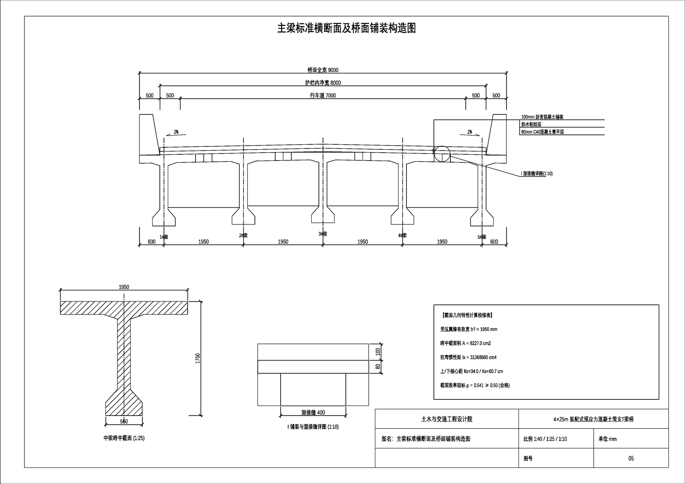<br/>
      <sub><b>图 05 · 主梁标准横断面及铺装构造</b> — 5 片预制 C50 T 梁、真实 2% 双向横坡、梳状引线与截面特性校核表</sub>
    </td>
  </tr>
  <tr>
    <td width="50%" align="center">
      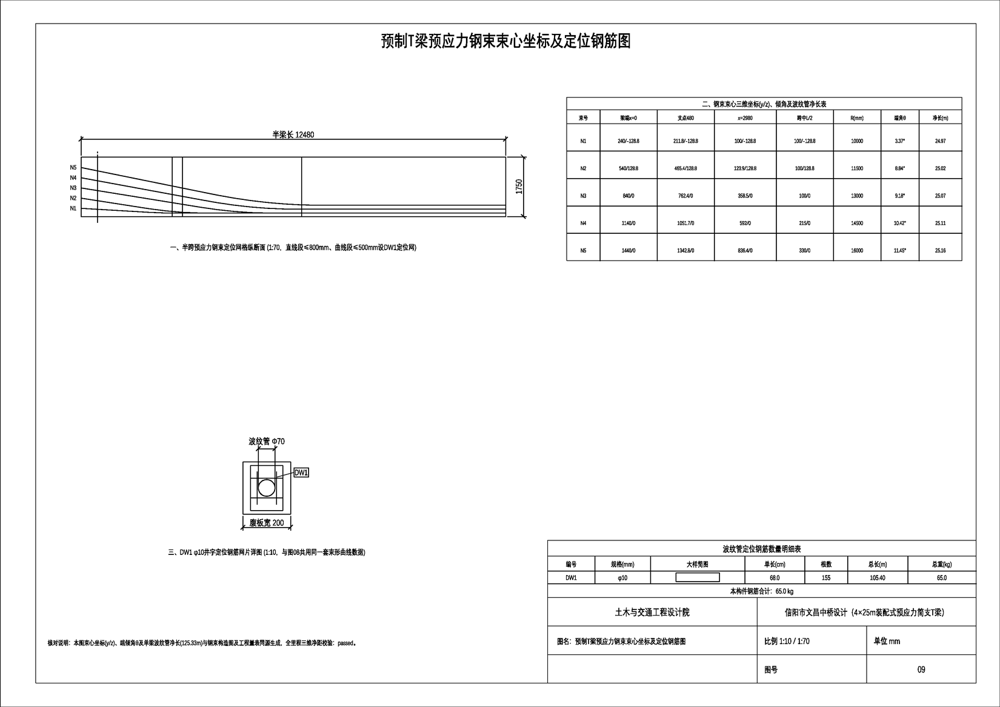<br/>
      <sub><b>图 09 · 三维钢束束心坐标及定位网</b> — 含 y/z 空间坐标表、端倾角、波纹管净长及 <code>DW1</code> 井字定位网大样</sub>
    </td>
    <td width="50%" align="center">
      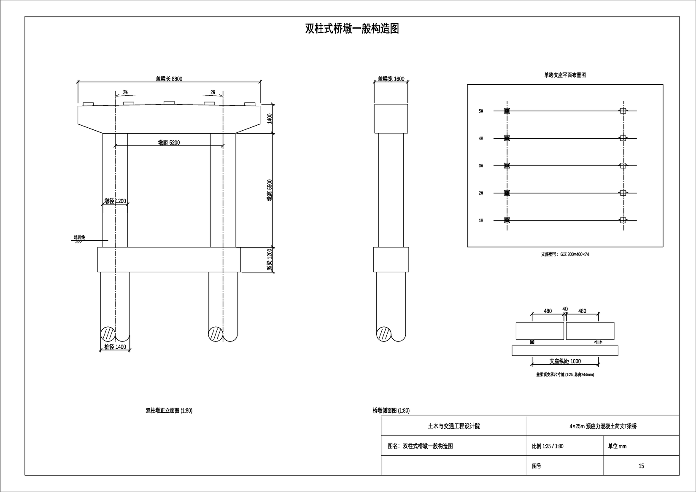<br/>
      <sub><b>图 15 · 双柱式桥墩一般构造图</b> — 双柱 + 桩顶系梁 + 钻孔桩，右下角与图 06/13 共用 <code>480+40+480=1000 mm</code> 支承链</sub>
    </td>
  </tr>
</table>

<details>
<summary><b>🔩 展开查看：下部关键节点钢筋详图（图 19-1 桩顶系梁构造及节点锚固详图）</b></summary>
<br/>
<p align="center">
  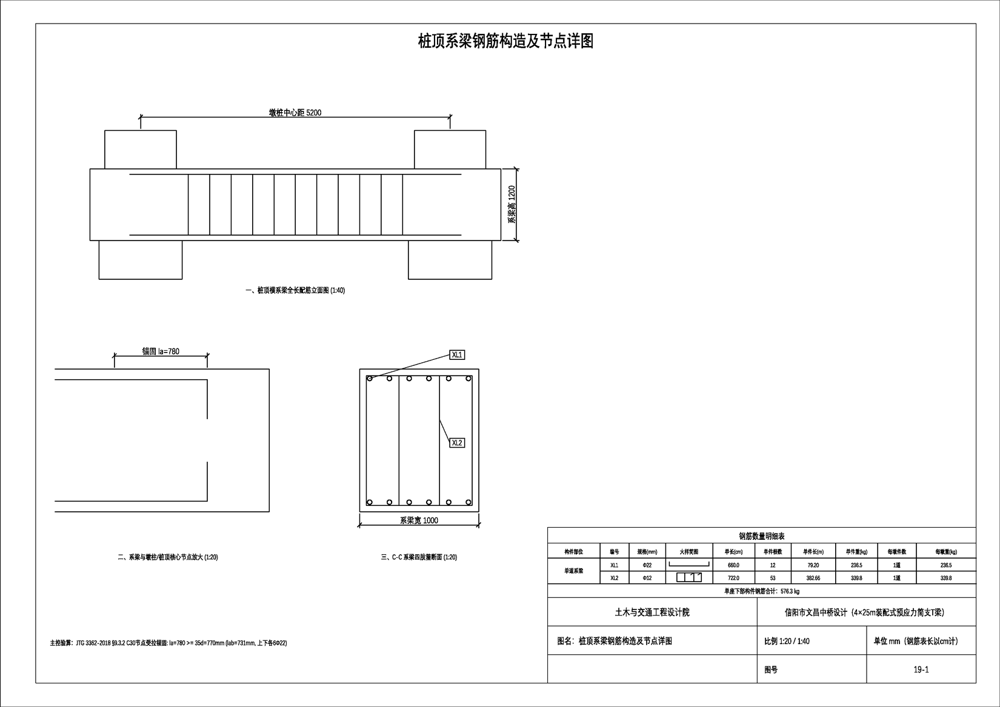<br/>
  <sub><b>图 19-1 · 桩顶系梁钢筋构造及节点详图</b> — 全长配筋立面、核心节点受拉锚固放大（<code>la=780 mm ≥ 35d</code>）、四肢箍断面与材料明细表同源联动。</sub>
</p>
</details>

### 3. 论文与答辩 PPT 专用 300 DPI 计算插图展示

<p align="center">
  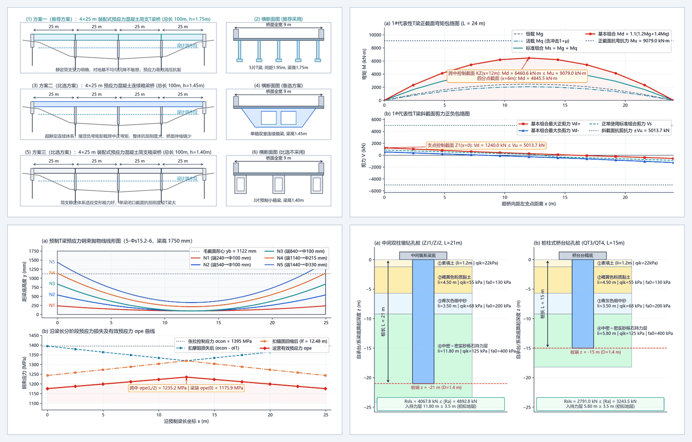<br/>
  <sub><b>自动生成的说明书与答辩 PPT 高清计算插图</b> — 左上：开题三桥型方案立面与横断面比选 · 右上：1#代表梁弯矩与剪力组合包络图 · 左下：预应力钢束线形与沿程有效预应力曲线 · 右下：中墩（21 m）与桥台（15 m）钻孔桩分层地层承载力对比</sub>
</p>

### 4. Web Studio 可视化桥梁工作台与“圈哪改哪”交互审改 UI

内置 **Web Studio（`/studio`）** 专设 **`5. 🌉 土木桥梁`** 工作台与 **`6. ✏️ 局部精改`** 面板，并与智能体对话侧栏的 **MCP 交互审图台（`cad_open_viewer`）** 无缝打通：

<p align="center">
  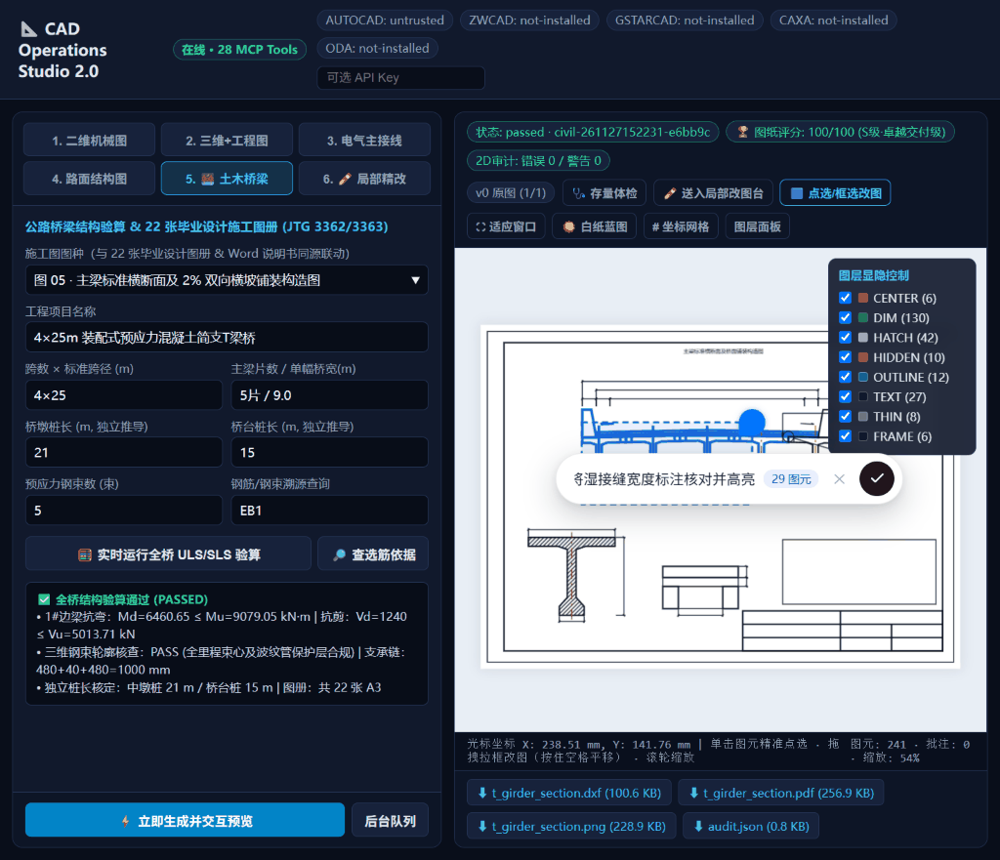<br/>
  <sub><b>Web Studio <code>5. 🌉 土木桥梁</code> 交互工作台</b> — 左侧一键执行全桥 ULS/SLS 抗弯抗剪验算、三维钢束净距核查与钢筋编号（如 <code>EB1</code> / <code>N4</code>）选筋依据溯源；右侧白底矢量画布支持无级缩放、图层显隐开关，以及<b>拉出蓝色虚线框直接“圈哪改哪”</b>的悬浮胶囊批注条</sub>
</p>

<p align="center">
  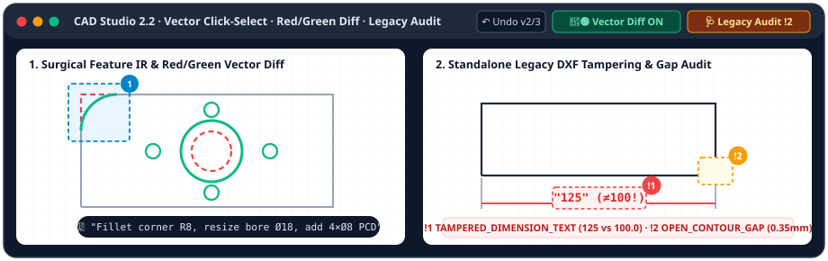<br/>
  <sub><b>局部精改与存量体检 UI</b> — 左：图元级点选/框选 + <b>红绿无损矢量叠图 Diff</b> + 多步撤销/重做 · 右：<b>存量图纸篡改假尺寸 <code>!1</code> 与断口微缝 <code>!2</code> 自动打点定位</b></sub>
</p>

---

## 你可以用它做什么

- **[土木与公路桥梁全套毕设/施工图一键交付](references/civil-bridge-engineering.md)**：一行命令输出 **22 张 A3 施工图 DXF + 带书签合并打印 PDF + 6 幅 300 DPI 计算图 + 学院模板正式 Word 说明书 `graduation_thesis.docx`**，支持接入桥梁博士上下部分册电算与参考 `.docx`/`.dxf` 模板自动学习。
- **[从文档直出审计级机械/电气/市政二维蓝图与三维 STEP](#七大核心引擎)**：自动提取参数并拦截缺失/冲突项，原生绘制直齿圆柱齿轮、轴承透盖、带筋支座、法兰、阶梯轴三视图，内置国标水平横梁 `Ra` 粗糙度、基准框 `[A]/[B]` 与形位公差框。
- **[矢量级“指哪改哪”与红绿叠图 Diff](#七大核心引擎)**：单击图元或拉出蓝色虚线框，支持口语或结构化 IR 执行**改孔径、拐角倒角（`C5`）、相切倒圆角（`R8`）、新增圆周螺栓孔阵（`PCD`）、对称镜像**，自动换算英制/公制 `$INSUNITS` 并严防污染框外尺寸。
- **[外部存量脏图纸（Legacy DXF）防篡改体检与清洗](#七大核心引擎)**：无需内部规约，直接揪出**人为改写文字的“篡改假尺寸”**、炸开散落标注、导致激光切割中断的 `0.35 mm` 轮廓微缝、重线与文字压线，支持一键原子清洗。
- **[通过 28 项 MCP 工具与 Web Studio 赋能任意 Agent](#mcp-与智能体接入)**：同时支持 `stdio`、Streamable HTTP、项目偏好与模板记忆（`.cad-memory/`）、错题回归飞轮与内置 `/studio` 交互画布。

### 一键生成全套桥梁毕业设计成果（22 张 A3 施工图 + 合并 PDF + Word 论文）：

```powershell
# 1. 免配置一键生成 22 张 A3 施工图 + 带书签合并打印 PDF + 6 幅 300DPI 计算图 + 正式说明书(.docx)
python scripts/run_bridge_suite.py --out output/wenchang_22_suite

# 2. 自动学习本校参考论文(.docx)与参考施工图(.dxf)样式，并导入桥梁博士电算结果与三维钢束坐标
python scripts/run_bridge_suite.py --out output/custom_suite `
  --learn-docx ref_thesis.docx --learn-dxf ref_dxf_dir `
  --fem-results fem_super.json --substructure-fem fem_sub.json --drbridge-tendon-model new.txt
```

### 8 行 Python 完成外部存量图纸体检清洗 + 四角相切倒圆角：

```python
from cad_skill_core.inspection import audit_legacy_dxf, clean_legacy_dxf
from cad_skill_core.revision.nl_revise import execute_nl_region_revision

# 1. 对外部来图做独立体检（检测篡改尺寸、炸开标注、微缝断口）并自动去重/闭合微缝
report = audit_legacy_dxf("incoming_vendor.dxf")
clean_legacy_dxf("incoming_vendor.dxf", "cleaned.dxf", close_micro_gaps_tol=0.6)

# 2. 受控执行几何特征编辑（compare_untouched 保证非目标图元 0 误改！）
res = execute_nl_region_revision("cleaned.dxf", "out_rev", "全部四个角倒圆角 R5", candidate_handles=["1A"])
print(res["summary_zh"], "-> 修改句柄:", res["modified_handles"])
```

### 一键启动 Web Studio 可视化自动出图与桥梁交互工作台：

```powershell
$env:PYTHONPATH = "runtime/cad-2d-skill/src"
python -B -m cad_skill_core.cli mcp-http --host 127.0.0.1 --port 8765 --workspace output/mcp_workspace
# 浏览器打开 http://127.0.0.1:8765/studio 即可进入机械/三维/电气/路面/土木桥梁/局部精改六合一工作台！
```

---

## 七大核心引擎

<table>
  <tr>
    <td width="236" align="center">
      
    </td>
    <td>
      <b>土木与公路桥梁结构计算及 22 张图册引擎</b> — 覆盖水文跨径、刚性横梁/偏压横向分布、预应力损失、三维钢束越界审计、二维平面刚架下部复核、桥梁博士逐项验收、参考 <code>.docx/.dxf</code> 样式自学习、正式 Word 说明书及 22 张 A3 施工图册。<a href="references/civil-bridge-engineering.md">详情 →</a>
    </td>
  </tr>
  <tr>
    <td width="236" align="center">
      
    </td>
    <td>
      <b>GB/T 与 ISO 二维参数化制图引擎</b> — 解析 <code>.md</code> / <code>.docx</code> / <code>.pdf</code> / <code>.csv</code>，内置机械精加工、重工总装、市政土建与 ISO 英文四套标准预设，原生输出全矢量粗糙度、形位公差、4 列国标明细表及 100 分制 Rubric 评分。
    </td>
  </tr>
  <tr>
    <td width="236" align="center">
      
    </td>
    <td>
      <b>结构化改图 IR（<code>v2</code>）与红绿矢量叠图对比</b> — 上层支持 LLM/Agent 结构化 JSON IR 与多子句否定剥离编译，下层提供新增圆孔、圆周孔阵、倒角、圆角、镜像等几何原语，配合 SHA-256 锁与 <code>compare_untouched</code> 事务回滚。<a href="references/revision-tools.md">详情 →</a>
    </td>
  </tr>
  <tr>
    <td width="236" align="center">
      
    </td>
    <td>
      <b>存量脏图纸（Legacy DXF）防篡改体检与清洗器</b> — 零前置规约依赖，精准识别实测值与文字不符的篡改假尺寸（<code>TAMPERED_DIMENSION_TEXT</code>）、炸开标注、未闭合轮廓断口、零长退化线、重叠图元与文字穿线干涉，并在画布自动打点定位。
    </td>
  </tr>
  <tr>
    <td width="236" align="center">
      
    </td>
    <td>
      <b>三维水密流形内核与 3D→2D 联动投影</b> — 零商业软件依赖构建水密流形实体（完整轮齿+平键槽直齿轮、双腔轴承透盖、带筋支座、多特征沉头孔组合体），导出工业标准 <b>ISO 10303-21 <code>.step</code></b> / <code>.glb</code> / <code>.stl</code> 并联动生成二维工程图。
    </td>
  </tr>
  <tr>
    <td width="236" align="center">
      
    </td>
    <td>
      <b>跨版本 AutoCAD 与国产 CAD 原生驱动层</b> — 支持 <b>AutoCAD 2021–2026</b>、<b>中望 CAD</b>、<b>浩辰 CAD</b>、<b>CAXA</b> 与 <b>ODA</b> 的数字签名验证探测、白名单受控全齿廓/加强筋 <code>3DSOLID</code> 脚本建模及 <code>DWG ↔ DXF</code> 双向无损核验。
    </td>
  </tr>
  <tr>
    <td width="236" align="center">
      
    </td>
    <td>
      <b>28 项强校验 MCP 工具与 Web Studio 交互工作台</b> — 原生对接 Claude Code、Cursor、Codex 与 Antigravity，内置目录越界沙箱、DXF 炸弹防护、子进程 UTF-8 异步任务队列、土木桥梁实时验算面板、矢量悬停点选及多步版本回退树。<a href="references/mcp-server-guide.md">接入指南 →</a>
    </td>
  </tr>
</table>

---

## 快速开始

### 1. 环境安装（Python 3.12+）

```powershell
git clone https://github.com/XiaoGuai23/cad-operations-skill.git
cd cad-operations-skill
py -3.12 -m venv .venv
.\.venv\Scripts\python.exe -m pip install -r requirements.txt -e "./runtime/cad-2d-skill[dev]"
```

### 2. 运行全量验证套件（`1,059+` 项自动化测试）

```powershell
python tests/smoke_test.py
$env:PYTHONPATH = "runtime/cad-2d-skill/src;runtime/cad-2d-skill"
python -m pytest runtime/cad-2d-skill/tests -q -m "not autocad"
```

---

## MCP 与智能体接入

在 Claude Code、Cursor（`.cursor/mcp.json`）或 Antigravity 的 MCP 配置中加入：

```json
{
  "mcpServers": {
    "cad-operations": {
      "command": "python",
      "args": [
        "-B", "-m", "cad_skill_core.cli", "mcp-stdio",
        "--workspace", "./output/mcp_workspace"
      ],
      "env": {
        "PYTHONPATH": "./runtime/cad-2d-skill/src",
        "PYTHONUTF8": "1"
      }
    }
  }
}
```

<details>
<summary><b>🛠️ 展开查看：命令行常用工作流速查表（桥梁 / 二维 / 三维 / 模板学习 / CAD-1K 评测）</b></summary>

```powershell
# 1) 从项目书编译二维规约 & 从参考论文(.docx)/样图(.dxf)学习模板样式
python -m cad_skill_core compile-spec examples/project_brief.md --out output/drawing-spec.json --json
python -m cad_skill_core learn-template --docx ref_thesis.docx --dxf ref_dxf_dir --out .cad-memory --json

# 2) 三维水密建模 (.step/.glb/.stl) + 3D->2D 国标多视图工程图一键联动
python -m cad_skill_core generate-3d model3d-spec.json --out output/part3d --with-2d-sheet --json

# 3) 探测本机 AutoCAD / 中望 / 浩辰 / ODA 驱动 & DWG<->DXF 往返无损校验
python -m cad_skill_core drivers --json
python -m cad_skill_core verify-roundtrip before.dxf after.dxf --json

# 4) Rubric 100分制审图打分 & 免视频 cad-1000-hours 离线基准评测
python -m cad_skill_core score-drawing output/part3d/sheet2d.dxf --json
python -m cad_skill_core benchmark-cad1k --out output/cad1k-eval --json

# 5) 变电站电气主接线图、道路路面结构 & 全套22张A3桥梁施工图+Word说明书一键复现
python scripts/make_main_sld.py examples/electrical_sld_spec.json --outdir output/sld --stem demo_sld
python scripts/generate_pavement_cad_ezdxf.py examples/pavement_structure_spec.json --out output/pavement
python scripts/run_bridge_suite.py --out output/wenchang_22_sheets
```
</details>

---

## Star 趋势

<div align="center">
  <a href="https://star-history.com/#XiaoGuai23/cad-operations-skill&Date">
    <picture>
      <source media="(prefers-color-scheme: dark)" srcset="https://api.star-history.com/svg?repos=XiaoGuai23/cad-operations-skill&type=Date&theme=dark">
      <source media="(prefers-color-scheme: light)" srcset="https://api.star-history.com/svg?repos=XiaoGuai23/cad-operations-skill&type=Date">
      
    </picture>
  </a>
</div>

---

## 许可证与致谢

本项目采用 [MIT 许可证](LICENSE) 开源。原始技能基础源自 [2836048681/cad-operations-skill](https://github.com/2836048681/cad-operations-skill)，运行库中改编自 `ezdxf` 的渲染辅助代码版权声明详见 [THIRD_PARTY_NOTICES.md](runtime/cad-2d-skill/THIRD_PARTY_NOTICES.md)。原生 `.dwg` 转换与 ACIS 实体脚本依赖本机已安装且通过数字签名校验的 CAD 软件，仓库本身不包含任何商业 CAD 程序或商业字体文件。
