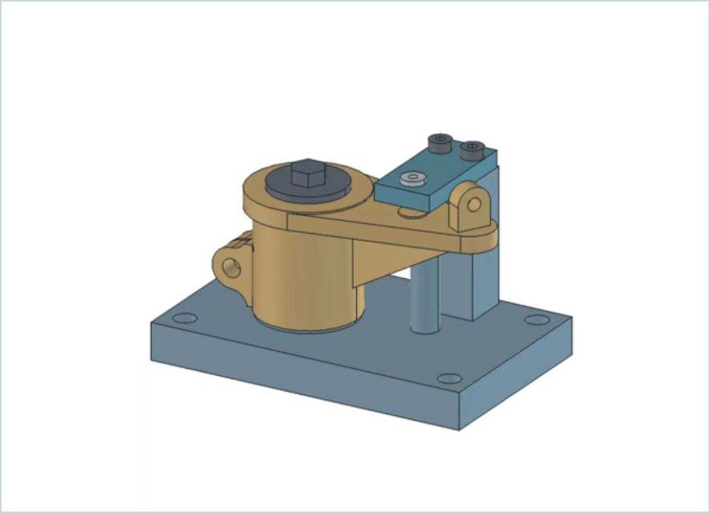
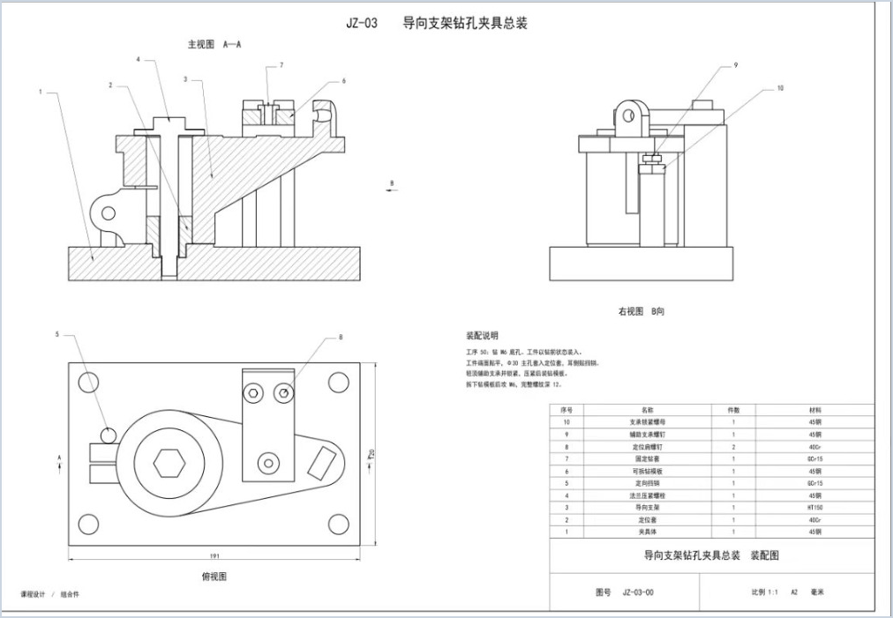

<div align="center">

<picture>
  <source media="(prefers-color-scheme: dark)" srcset="assets/hero-dark.svg">
  <source media="(prefers-color-scheme: light)" srcset="assets/hero-light.svg">
  
</picture>

<h3>面向 AI 智能体的零幻觉二维/三维 CAD 自动出图、矢量级局部精改与工程审图引擎</h3>

<!-- 语言切换胶囊 -->
<p>
  <a href="README.md"></a>
  <a href="README_ZH.md"></a>
</p>

<!-- 状态与核心能力徽章墙 -->
<p>
  <a href="https://github.com/XiaoGuai23/cad-operations-skill/actions/workflows/smoke-test.yml"></a>
  <a href="https://github.com/XiaoGuai23/cad-operations-skill/releases"></a>
  
  
  <a href="references/mcp-server-guide.md"></a>
  <a href="SKILL.md"></a>
  <a href="LICENSE"></a>
</p>

<p>
  
  
</p>

<!-- 快捷锚点导航 -->
<p>
  <a href="#%E5%AE%9E%E6%99%AF%E6%A1%88%E4%BE%8B%E7%94%BB%E5%BB%8A"><b>实景案例画廊</b></a> ·
  <a href="#%E4%BD%A0%E5%8F%AF%E4%BB%A5%E7%94%A8%E5%AE%83%E5%81%9A%E4%BB%80%E4%B9%88"><b>核心用法</b></a> ·
  <a href="#%E5%85%AD%E5%A4%A7%E6%A0%B8%E5%BF%83%E5%BC%95%E6%93%8E"><b>六大核心引擎</b></a> ·
  <a href="#%E5%BF%AB%E9%80%9F%E5%BC%80%E5%A7%8B"><b>快速开始</b></a> ·
  <a href="#mcp-%E4%B8%8E%E6%99%BA%E8%83%BD%E4%BD%93%E6%8E%A5%E5%85%A5"><b>MCP 接入</b></a> ·
  <a href="README.md"><b>English</b></a>
</p>

</div>

---

**CAD Operations Skill** 是一套专为 AI 编程智能体（**Claude Code、Cursor、Codex、Antigravity**）及工业自动化管线打造的 **二维 + 三维全闭环 CAD 智能制图、受控局部修订与存量图纸体检平台**。

它不仅能将 `.docx` / `.pdf` / `.md` 项目书自动编译为**零压线的国标（GB/T）与 ISO 二维工程图**及**水密流形三维 `.step` / `.glb` 模型**，更能直接吞入外部存量脏图纸执行**篡改假尺寸检测与微缝断口修复**，并通过 **Web Studio 2.2 矢量点选 + 红绿叠图 Diff + `compare_untouched` 全图零越界护栏**，确保改图过程 100% 确定、可追溯、可回滚。

---

## 实景案例画廊

<table>
  <tr>
    <td width="50%" align="center">
      <br/>
      <sub><b>三维机械夹具总装模型</b> — 导向支架钻孔夹具多零件装配实体</sub>
    </td>
    <td width="50%" align="center">
      <br/>
      <sub><b>1:1 联动国标二维总装工程图</b> — <code>A-A</code> 全剖剖面线、序号指引线与自下而上 10 行国标明细表</sub>
    </td>
  </tr>
  <tr>
    <td width="50%" align="center">
      <br/>
      <sub><b>多板冲压模具三维装配</b> — 12 组件彩色分层 STEP 装配结构树</sub>
    </td>
    <td width="50%" align="center">
      <br/>
      <sub><b>下游 CNC CAM 刀路直连</b> — 水密流形实体无缝导入 CAM 生成铣削与钻孔刀路</sub>
    </td>
  </tr>
</table>

<p align="center">
  <br/>
  <sub><b>Web Studio 2.2 交互工作台</b> — 左：图元级点选/框选 + <b>红绿无损矢量叠图 Diff</b> + 多步撤销/重做 · 右：<b>存量图纸篡改假尺寸 <code>!1</code> 与断口微缝 <code>!2</code> 自动定位</b></sub>
</p>

<details>
<summary><b>📐 展开查看：市政污水处理厂全厂水力及污泥流程高程布置图示例</b></summary>
<br/>
<p align="center">
  <br/>
  <sub>覆盖机械零件与夹具总装、变电站电气主接线图（SLD）、道路沥青路面结构图与市政工艺高程图等多专业制图场景。</sub>
</p>
</details>

---

## 你可以用它做什么

- **[从文档直出审计级二维蓝图与三维 STEP](#六大核心引擎)**：自动提取参数并拦截缺失/冲突项，原生绘制直齿圆柱齿轮、轴承透盖、带筋支座、法兰、阶梯轴三视图，内置国标水平横梁 `Ra` 粗糙度、基准框 `[A]/[B]` 与带折弯引线的形位公差框。
- **[矢量级“指哪改哪”与红绿叠图 Diff](#六大核心引擎)**：单击图元或拉出蓝色虚线框，支持口语或结构化 IR 执行**改孔径、拐角倒角（`C5`）、相切倒圆角（`R8`）、新增圆周螺栓孔阵（`PCD`）、对称镜像**，自动换算英制/公制 `$INSUNITS` 并严防污染框外尺寸。
- **[外部存量脏图纸（Legacy DXF）防篡改体检与清洗](#六大核心引擎)**：无需内部规约，直接揪出**人为改写文字的“篡改假尺寸”**、炸开散落标注、导致激光切割中断的 `0.35 mm` 轮廓微缝、重线与文字压线，支持一键原子清洗。
- **[通过 23 项 MCP 工具与 Web Studio 赋能任意 Agent](#mcp-与智能体接入)**：同时支持 `stdio`、Streamable HTTP 与内置 `/studio` 交互画布（悬停捕捉、图层开关、批注二次编辑、多步 Undo/Redo）。

### 8 行 Python 完成外部存量图纸体检清洗 + 四角相切倒圆角：

```python
from cad_skill_core.inspection import audit_legacy_dxf, clean_legacy_dxf
from cad_skill_core.revision.nl_revise import execute_nl_region_revision

# 1. 对外部来图做独立体检（检测篡改尺寸、炸开标注、微缝断口）并自动去重/闭合微缝
report = audit_legacy_dxf("incoming_vendor.dxf")
clean_legacy_dxf("incoming_vendor.dxf", "cleaned.dxf", close_micro_gaps_tol=0.6)

# 2. 受控执行几何特征编辑（compare_untouched 保证非目标图元 0 误改！）
res = execute_nl_region_revision("cleaned.dxf", "out_rev", "全部四个角倒圆角 R5", candidate_handles=["1A"])
print(res["summary_zh"], "-> 修改句柄:", res["modified_handles"])
```

### 一键启动 Web Studio 2.2 可视化自动出图与审改工作台：

```powershell
$env:PYTHONPATH = "runtime/cad-2d-skill/src"
python -B -m cad_skill_core.cli mcp-http --host 127.0.0.1 --port 8765 --workspace output/mcp_workspace
# 浏览器打开 http://127.0.0.1:8765/studio 即可交互出图、点选精改与红绿对比！
```

---

## 六大核心引擎

<table>
  <tr>
    <td width="236" align="center">
      
    </td>
    <td>
      <b>GB/T 与 ISO 二维参数化制图引擎</b> — 解析 <code>.md</code> / <code>.docx</code> / <code>.pdf</code> / <code>.csv</code>，内置机械精加工、重工总装、市政土建与 ISO 英文四套标准预设，原生输出全矢量粗糙度、形位公差、4 列国标明细表及 100 分制 Rubric 评分。
    </td>
  </tr>
  <tr>
    <td width="236" align="center">
      
    </td>
    <td>
      <b>结构化改图 IR（<code>v2</code>）与红绿矢量叠图对比</b> — 上层支持 LLM/Agent 结构化 JSON IR 与多子句否定剥离编译，下层提供新增圆孔、圆周孔阵、倒角、圆角、镜像等几何原语，配合 SHA-256 锁与 <code>compare_untouched</code> 事务回滚。<a href="references/revision-tools.md">详情 →</a>
    </td>
  </tr>
  <tr>
    <td width="236" align="center">
      
    </td>
    <td>
      <b>存量脏图纸（Legacy DXF）防篡改体检与清洗器</b> — 零前置规约依赖，精准识别实测值与文字不符的篡改假尺寸（<code>TAMPERED_DIMENSION_TEXT</code>）、炸开标注、未闭合轮廓断口、零长退化线、重叠图元与文字穿线干涉，并在画布自动打点定位。
    </td>
  </tr>
  <tr>
    <td width="236" align="center">
      
    </td>
    <td>
      <b>三维水密流形内核与 3D→2D 联动投影</b> — 零商业软件依赖构建水密流形实体（完整轮齿+平键槽直齿轮、双腔轴承透盖、带筋支座、多特征沉头孔组合体），导出工业标准 <b>ISO 10303-21 <code>.step</code></b> / <code>.glb</code> / <code>.stl</code> 并联动生成二维工程图。
    </td>
  </tr>
  <tr>
    <td width="236" align="center">
      
    </td>
    <td>
      <b>跨版本 AutoCAD 与国产 CAD 原生驱动层</b> — 支持 <b>AutoCAD 2021–2026</b>、<b>中望 CAD</b>、<b>浩辰 CAD</b>、<b>CAXA</b> 与 <b>ODA</b> 的数字签名验证探测、白名单受控全齿廓/加强筋 <code>3DSOLID</code> 脚本建模及 <code>DWG ↔ DXF</code> 双向无损核验。
    </td>
  </tr>
  <tr>
    <td width="236" align="center">
      
    </td>
    <td>
      <b>23 项强校验 MCP 工具与 Web Studio 2.2</b> — 原生对接 Claude Code、Cursor、Codex 与 Antigravity，内置目录越界沙箱、DXF 炸弹防护、子进程 UTF-8 异步任务队列、矢量悬停点选及多步版本回退树。<a href="references/mcp-server-guide.md">接入指南 →</a>
    </td>
  </tr>
</table>

---

## 快速开始

### 1. 环境安装（Python 3.12+）

```powershell
git clone https://github.com/XiaoGuai23/cad-operations-skill.git
cd cad-operations-skill
py -3.12 -m venv .venv
.\.venv\Scripts\python.exe -m pip install -r requirements.txt -e "./runtime/cad-2d-skill[dev]"
```

### 2. 运行全量验证套件（`1,024+` 项自动化测试）

```powershell
python tests/smoke_test.py
$env:PYTHONPATH = "runtime/cad-2d-skill/src;runtime/cad-2d-skill"
python -m pytest runtime/cad-2d-skill/tests -q -m "not autocad"
```

---

## MCP 与智能体接入

在 Claude Code、Cursor（`.cursor/mcp.json`）或 Antigravity 的 MCP 配置中加入：

```json
{
  "mcpServers": {
    "cad-operations": {
      "command": "python",
      "args": [
        "-B", "-m", "cad_skill_core.cli", "mcp-stdio",
        "--workspace", "./output/mcp_workspace"
      ],
      "env": {
        "PYTHONPATH": "./runtime/cad-2d-skill/src",
        "PYTHONUTF8": "1"
      }
    }
  }
}
```

<details>
<summary><b>🛠️ 展开查看：命令行常用工作流速查表（二维 / 三维 / 驱动 / CAD-1K 评测）</b></summary>

```powershell
# 1) 从项目书编译二维规约 & 从参考样图学习图层/标注标准
python -m cad_skill_core compile-spec examples/project_brief.md --out output/drawing-spec.json --json
python -m cad_skill_core learn-standard sample.dxf --out output/custom-standard.yaml --json

# 2) 三维水密建模 (.step/.glb/.stl) + 3D->2D 国标多视图工程图一键联动
python -m cad_skill_core generate-3d model3d-spec.json --out output/part3d --with-2d-sheet --json

# 3) 探测本机 AutoCAD / 中望 / 浩辰 / ODA 驱动 & DWG<->DXF 往返无损校验
python -m cad_skill_core drivers --json
python -m cad_skill_core verify-roundtrip before.dxf after.dxf --json

# 4) Rubric 100分制审图打分 & 免视频 cad-1000-hours 离线基准评测
python -m cad_skill_core score-drawing output/part3d/sheet2d.dxf --json
python -m cad_skill_core benchmark-cad1k --out output/cad1k-eval --json

# 5) 变电站电气主接线图 & 道路路面结构专项出图
python scripts/make_main_sld.py examples/electrical_sld_spec.json --outdir output/sld --stem demo_sld
python scripts/generate_pavement_cad_ezdxf.py examples/pavement_structure_spec.json --out output/pavement
```
</details>

---

## Star 趋势

<div align="center">
  <a href="https://star-history.com/#XiaoGuai23/cad-operations-skill&Date">
    <picture>
      <source media="(prefers-color-scheme: dark)" srcset="https://api.star-history.com/svg?repos=XiaoGuai23/cad-operations-skill&type=Date&theme=dark">
      <source media="(prefers-color-scheme: light)" srcset="https://api.star-history.com/svg?repos=XiaoGuai23/cad-operations-skill&type=Date">
      
    </picture>
  </a>
</div>

---

## 许可证与致谢

本项目采用 [MIT 许可证](LICENSE) 开源。原始技能基础源自 [2836048681/cad-operations-skill](https://github.com/2836048681/cad-operations-skill)，运行库中改编自 `ezdxf` 的渲染辅助代码版权声明详见 [THIRD_PARTY_NOTICES.md](runtime/cad-2d-skill/THIRD_PARTY_NOTICES.md)。原生 `.dwg` 转换与 ACIS 实体脚本依赖本机已安装且通过数字签名校验的 CAD 软件，仓库本身不包含任何商业 CAD 程序或商业字体文件。
