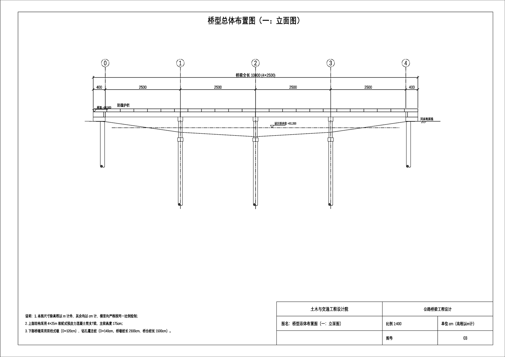
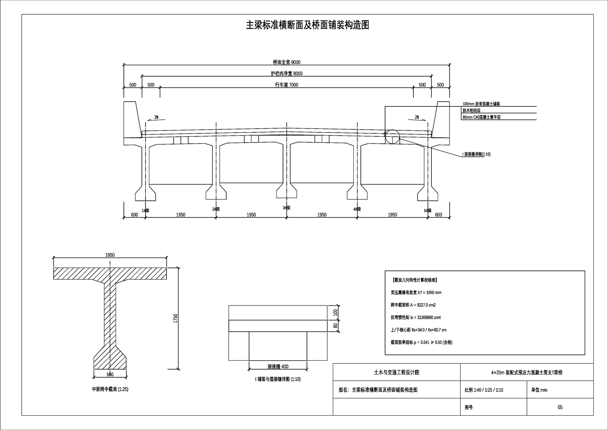
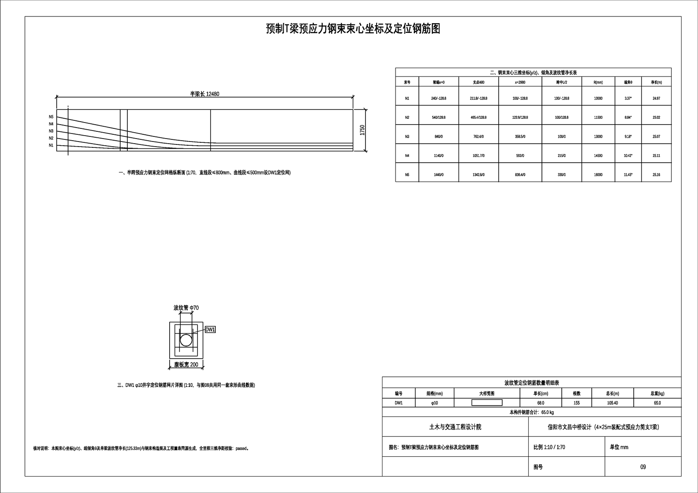
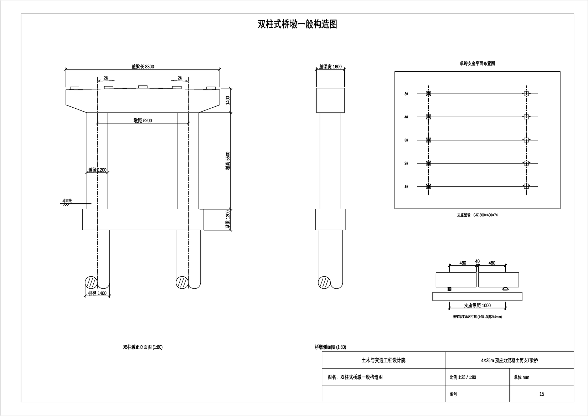
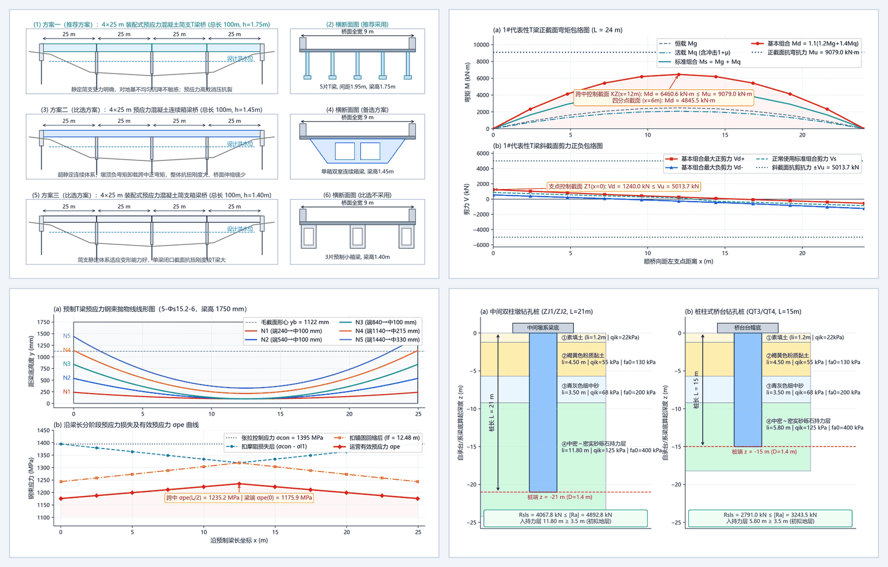
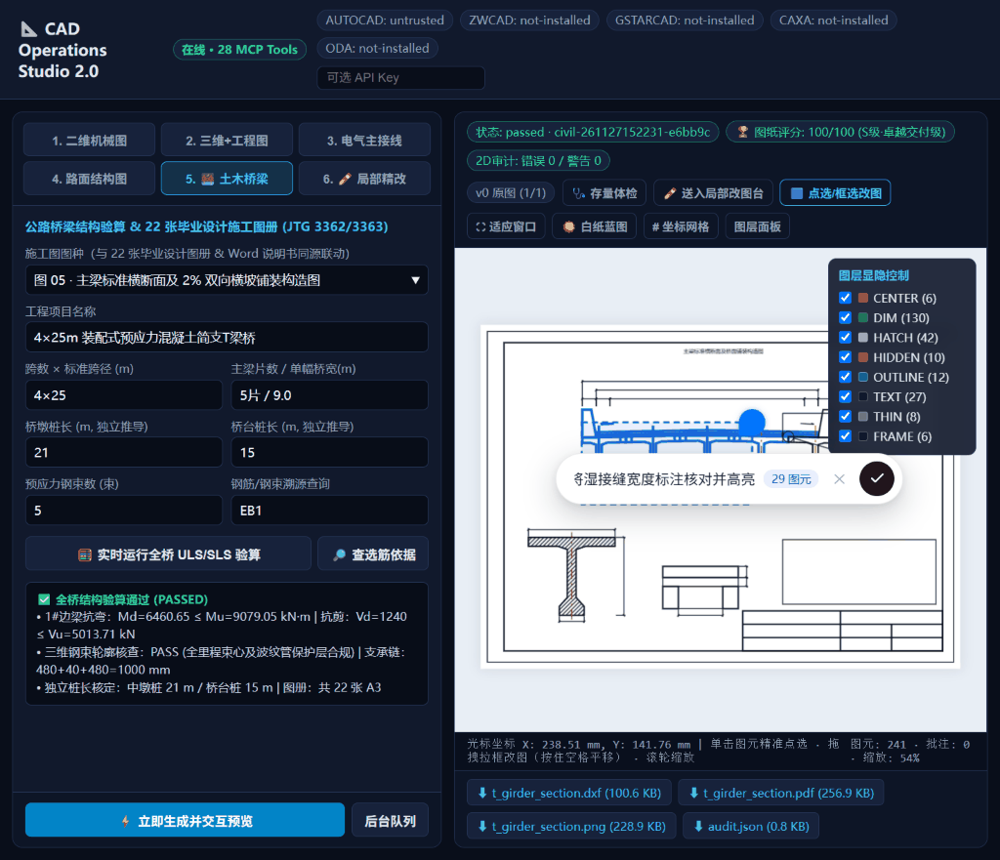

# 土木与桥梁工程结构计算、Word 说明书组装、模板自学习、电算复核与全套 22 张施工图指南（`civil` 套件 `v2.9`）

本模块（`cad_skill_core.civil`）实现了**零商业软件依赖**的公路桥梁结构计算、独立桥台与桩基验算、Word/PPT 高清计算图生成、参考 `.docx`/`.dxf` 模板样式自动学习、学院模板正式毕业设计说明书（`.docx`）组装、手算与独立有限元电算答辩逐项复核表、三维预应力钢束越界与支承尺寸链联动校核、DXF 语义内容哈希变更追踪、重开 DXF 实测核验及全套 **22 张 A3 施工图（`01 ~ 21`，含 `09` 束心坐标、`18` 盖梁弯起筋及挡块、`19-1` 系梁节点、`21` 耳背墙展开，并兼容 `QL-01 ~ QL-18` 18 张方案）**输出，严格遵循 `JTG B01-2014`、`JTG D60-2015`、`JTG 3362-2018`、`JTG 3363-2019`、`JTG/T 2231-01-2020`、`JT/T 4-2019` 及 `GB 1499.1/2-2024`。

---

## 1. 可制作成果总览与毕业设计样图画廊

### 1.1 全套 22 张 A3 桥梁施工图册清单（覆盖任务书全部 9 大类）

| 图号 | 图纸名称 | 对应任务书类别 | 核心构造与联动校核要点 |
| :---: | :--- | :--- | :--- |
| `01` | 桥梁设计总说明及图表目录 | ⑨ 说明与工程量 | 与合并 PDF 书签、Word 附录共读同一份 `sheet_manifest` |
| `02` | 全桥主要工程材料数量总表 | ⑨ 说明与工程量 | 混凝土、普通钢筋、钢绞线、波纹管、支座全桥汇总同源校核 |
| `03` | 桥型总体布置图（一：立面图 `1:400`） | ① 桥型总体布置 | 设计洪水位、中墩 `21 m` 与桥台 `15 m` 独立桩长、桩底 `S` 折断符 |
| `04` | 桥型总体布置图（二：平面及地质纵断面图） | ① 桥型总体布置 | 路线桩号、钻孔地层分层与持力层入层深度标注 |
| `05` | 主梁标准横断面及桥面铺装构造图 | ② 主梁一般构造 | 5 片预制 `C50` T 梁、真实 `2%` 双向横坡、薄层梳状引线、`1:10` 湿接缝 |
| `06` | 预制 T 梁一般构造图（一：纵断面及平面） | ② 主梁一般构造 | 变截面腹板（`200～360 mm`）及与 `13/15` 共用的支承位置坐标 |
| `07` | 预制 T 梁一般构造图（二：跨中/支点横断面） | ② 主梁一般构造 | 端截面、四分点、跨中马蹄与翼缘渐变几何核验 |
| `08` | 预制 T 梁预应力钢束构造图 | ③ 预应力钢束 | `N1～N5` 平竖弯线形、锚具张拉端局部加强钢筋网 |
| `09` | 预制 T 梁预应力钢束束心坐标及定位钢筋图 | ③ 预应力钢束 | 逐断面三维 `y/z` 坐标表、端倾角、波纹管净长与 `DW1` 井字定位网 |
| `10` | 预制 T 梁梁肋普通钢筋构造图 | ④ 主梁普通钢筋 | 架立筋、水平纵向分布筋及支点 `@100` / 跨中 `@150` 实画双肢箍筋 |
| `11` | 预制 T 梁翼缘（行车道板）钢筋构造图 | ⑤ 行车道板钢筋 | 悬臂板负弯矩主筋、湿接缝环形连接筋及分布钢筋表 |
| `12` | 端横隔梁及中横隔梁钢筋构造图 | ⑥ 横隔梁钢筋 | 横向联系主筋、弯起斜筋及湿接头焊接钢板详图 |
| `13` | 板式橡胶支座及支座垫石构造图 | ⑦ 支座与附属 | `GJZ` / `GYZF4` 支座排布、`C40` 垫石环氧砂浆找平及防震锚栓 |
| `14` | 桥面连续、伸缩缝、防撞护栏及泄水管构造图 | ⑦ 支座与附属 | 墩顶桥面连续负弯矩筋、`SS80` 模数式伸缩缝与 `SA` 级墙式护栏 |
| `15` | 双柱式桥墩一般构造图 | ⑧ 下部桥墩桥台 | 盖梁 `2%` 横坡、双柱 + 系梁 + 桩基及 `480+40+480=1000 mm` 支承链 |
| `16` | 桩柱式桥台一般构造图 | ⑧ 下部桥墩桥台 | 台帽、背墙、耳墙、锥坡及 `15 m` 钻孔灌注桩一般构造 |
| `17` | 桥墩盖梁钢筋构造图（一：主筋及箍筋） | ⑧ 下部钢筋详图 | 悬臂与跨中正负弯矩骨架、四肢加密箍筋与大样简图 |
| `18` | 桥墩盖梁钢筋构造图（二：弯起筋及抗震挡块） | ⑧ 下部钢筋详图 | 斜截面抗剪弯起筋及盖梁端部抗震挡块 `DK1/DK2` 配筋详图 |
| `19` | 桥墩墩柱及钻孔灌注桩钢筋构造图 | ⑧ 下部钢筋详图 | 圆形截面螺旋箍筋加密区、声测管布置与主筋笼分段搭接 |
| `19-1` | 桩顶系梁钢筋构造及节点详图 | ⑧ 下部钢筋详图 | 全长配筋立面、墩柱核心区受拉锚固（`la=780 mm ≥ 35d`）与 `XL1/XL2` 表 |
| `20` | 桩柱式桥台台帽及桩基钢筋构造图 | ⑧ 下部钢筋详图 | 台帽主筋骨架、挡块及桥台钻孔桩配筋明细 |
| `21` | 桥台耳墙及背墙钢筋展开图 | ⑧ 下部钢筋详图 | 耳墙双层双向钢筋网、背墙牛腿抗剪筋 `EB1～EB3` 展开大样 |

### 1.2 毕业设计样图、计算插图与 Web Studio 交互 UI 示例

<table>
  <tr>
    <td width="50%" align="center">
      <br/>
      <sub><b>图 03 · 桥型总体布置图（1:400 立面）</b></sub>
    </td>
    <td width="50%" align="center">
      <br/>
      <sub><b>图 05 · 主梁标准横断面及 2% 双向横坡铺装构造图</b></sub>
    </td>
  </tr>
  <tr>
    <td width="50%" align="center">
      <br/>
      <sub><b>图 09 · 三维钢束束心坐标及 <code>DW1</code> 定位钢筋网</b></sub>
    </td>
    <td width="50%" align="center">
      <br/>
      <sub><b>图 15 · 双柱式桥墩一般构造及 <code>480+40+480=1000 mm</code> 支承尺寸链</b></sub>
    </td>
  </tr>
</table>

<p align="center">
  <br/>
  <sub><b>说明书与答辩 PPT 专用 300 DPI 计算插图</b>（三方案比选、弯矩/剪力包络、钢束线形与预应力损失、墩台分层桩基对比）</sub>
</p>

<p align="center">
  <br/>
  <sub><b>Web Studio <code>5. 🌉 土木桥梁</code> 交互工作台</b> — 支持全桥 ULS/SLS 实时验算、钢筋编号 6 维溯源查询、图层面板显隐与蓝色虚线框“圈哪改哪”局部精改</sub>
</p>

---

## 2. 核心技术闭环与工程防错护栏（`v2.9`）

### 2.1 开题报告三桥型方案与双口径参考文献严格统一（`bridge_calc.py` + `bridge_calc_book.py`）
- **统一三套比选方案（`bridge_schemes`）**：默认读取与开题报告完全一致的三个同桥位方案——**方案一（推荐）：`4×25 m` 装配式预应力混凝土简支 T 梁桥（桥面连续）**、**方案二：`4×25 m` 预应力混凝土连续箱梁桥**、**方案三：`4×25 m` 装配式预应力混凝土简支箱梁桥**；支持挂载外部图片或自动绘制 6 幅方案对比图（`fig0_scheme_comparison.png/.svg`）。
- **任务书与开题报告双口径参考文献（`references` + `audit_references_compliance`）**：内置并自动核验 **12 篇 GB/T 7714 核心文献（中文 ≥ 10 篇 + 外文 ≥ 2 篇）**，全部 `[1] ~ [12]` 在计算书与正式说明书正文逐一实引（自动拦截悬空未引用文献）。

### 2.2 独立有限元软件逐项验收与下部平面刚架复核（`ingest_independent_fem_results` + `solve_independent_frame_fem`）
- 支持导入 **桥梁博士 Dr.Bridge（上部分册与下部分册）/ Midas Civil** 导出的 JSON、CSV、TSV 或 Markdown 表格（`--fem-results`、`--substructure-fem`）；
- **按必核项逐项核查构件、控制截面、荷载组合（严防“运营标准值”混入“基本组合”）、单位与来源**：缺项自动标注 **`partially_verified`（部分核对）**，生成的导入模板默认采用 `null` 空值与 `is_template: true`（原样导回绝不误判通过）；
- 内置复核求解器采用**真实二维平面刚架刚度矩阵 `[K]{u}={F}`**（盖梁 + 双柱 + 桩顶系梁 + 桩顶等效弹簧），诚实标注复核范围（`builtin_simplified_frame_fem`），并在导入桥梁博士下部分册真实结果后优先采用实算值。

### 2.3 三维钢束轮廓越界审计与共用支承尺寸链（`bridge_tendon_and_support.py`）
- 支持直接读取桥梁博士导出的 `new.txt` 或钢束/截面 JSON（`--drbridge-tendon-model`，兼容 `N1-1 ~ N5-1` 命名），按里程逐断面同时核查**束心、波纹管外缘、最小保护层与变截面腹板轮廓**（自动拦截如 `N4` 在距梁端 `2980 mm` 处越出 `200 mm` 腹板 `10 mm` 的工程隐患并阻断出图）；图 `08`、`09` 与图 `02` 波纹管工程量共用同一套三维几何对象；
- 图 `06`、`13`、`15` 共用同一份 `support_layout` 支承坐标生成并校验 **`480 + 40 + 480 = 1000 mm`** 纵向排距链与 **`20 + 74 + 150 = 244 mm`** 竖向支承高差链。

### 2.4 从参考 `.docx` / `.dxf` 自动学习模板样式与去敏感化说明书（`template_learner.py` + `bridge_thesis_docx.py`）
- **自动学习模板样式（`learn_template_styles`）**：支持直接传入本校往届优秀论文/学院模板 `.docx` 与设计院参考施工图 `.dxf`（或目录），自动提取页面边距、正文与 1～3 级标题中西文字体字号、对齐方式、三线表顶底线磅值、封面字段槽位，以及 CAD 图层颜色/线宽、SHX/TTF 字体与图签单位槽位，持久化到 `.cad-memory/` 供后续项目自动复用；
- **单一图册清单（`sheet_manifest`）共读**：DXF 图表目录（`01`）、22 页合并 A3 打印图册（含 PDF 书签大纲）、计算书第 6 章及正式说明书 **`graduation_thesis.docx`**（三级书签超链接目录、正文图号引用、附录表 1 图册清单）共用同一份清单；封面默认留白下划线栏位，零个人隐私残留。

### 2.5 按 DXF 几何/尺寸/文字/材料表做语义变更比对（`bridge_change_impact.py`）
- 采用 `compute_dxf_semantic_digest` 对归一化几何图元、原生 `DIMENSION`、文字与材料表 XDATA 计算确定性内容指纹：**参数不变原样重跑严格报告 0 张图纸变化**；修改桩长或钢束数时，精准列出真正发生内容变化的图号与计算书/说明书章节。

---

## 3. 命令行与交互 UI 快速复现入口

```powershell
# 1. 一键生成 22 张 A3 施工图 + 合并 PDF 图册 + 6 幅 300DPI 计算图 + 计算书(MD) + 正式说明书(DOCX)
python scripts/run_bridge_suite.py --out output/wenchang_suite

# 2. 导入桥梁博士上下部实算结果 + 钢束三维坐标 new.txt + 自定义封面信息
python scripts/run_bridge_suite.py --out output/wenchang_suite `
  --fem-results fem_super.json --substructure-fem fem_sub.json `
  --drbridge-tendon-model new.txt --student-info student.json

# 3. 从参考说明书 .docx 与参考施工图 DXF/文件夹自动学习模板样式并一键出全套成果
python scripts/run_bridge_suite.py --out output/custom_school_suite `
  --learn-docx ref_thesis.docx --learn-dxf ref_dxf_dir

# 4. 单独提取模板并存入 .cad-memory/ 供后续所有项目复用
python -m cad_skill_core.cli learn-template --docx ref_thesis.docx --dxf ref_dxf_dir --out .cad-memory

# 5. 任点图面一个钢筋/钢束编号（如 N4、DW1、GL3、EB1、QT3），一键查询 6 维选筋溯源信息
python scripts/run_bridge_suite.py --lookup-bar EB1

# 6. 启动 Web Studio 可视化桥梁工作台（打开 http://127.0.0.1:8765/studio 切换到 5. 🌉 土木桥梁）
$env:PYTHONPATH = "runtime/cad-2d-skill/src"
python -B -m cad_skill_core.cli mcp-http --host 127.0.0.1 --port 8765 --workspace output/mcp_workspace
```
